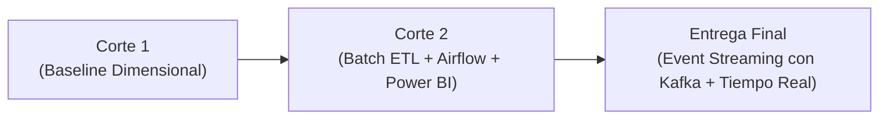

# Guía Maestra y Explicación Integral — Entrega Final de ETL
## Cómo entender, sustentar y defender tu proyecto de punta a punta

> **Propósito de este documento:** Explicar con total claridad el contexto, el problema de negocio, la arquitectura y **exactamente cómo fue construida cada pieza de esta Entrega Final**, para que comprendas el 100% del sistema y puedas sustentarlo con total seguridad ante tu profesor.

---

## 1. El Hilo Conductor: ¿De qué trata este proyecto?

### 1.1 El Problema Humano y de Negocio
La violencia intrafamiliar en Colombia es una de las mayores problemáticas estructurales del país. Históricamente, las entidades gubernamentales medían el problema contando simplemente el número de denuncias registradas por la **Policía Nacional (DIJIN)**.

Sin embargo, ese enfoque tiene una falla grave de ingeniería y de análisis:  
> **Contar denuncias solo mide el volumen reportado, no la capacidad real de atención.**  
> Si una ciudad registra muchas denuncias, a menudo es simplemente porque tiene oficinas abiertas donde la gente puede denunciar. En cambio, si una ciudad registra pocas denuncias, podría ser porque las víctimas no tienen a dónde acudir.

### 1.2 La Integración Clave: La Ley 2126 de 2021 y la API de Comisarías
Para solucionar esta ceguera, integramos una segunda fuente de datos vía API: el **Directorio de Comisarías de Familia del Ministerio de Justicia**.  

Además, aplicamos la **Ley 2126 de 2021**, que establece una norma legal muy clara:
* **Estándar legal:** Todo municipio en Colombia debe tener **al menos 1 Comisaría de Familia por cada 100.000 habitantes**.
* **La gran revelación:** Al cruzar las denuncias policiales con el directorio institucional, descubrimos que en Colombia **faltan 114 comisarías por construir**, y que el colapso más grave no está en Bogotá (que tiene 39 comisarías), sino en ciudades intermedias como **Cúcuta** (20.389 víctimas con solo 1 comisaría instalada y un déficit de 8) o **Soacha** (déficit de 6 comisarías).

### 1.3 Qué se hizo en cada corte



* **Corte 1:** Construcción del primer Data Warehouse en PostgreSQL para responder requerimientos descriptivos (R1 a R5: series temporales, departamentos, género, armas).
* **Corte 2:** Automatización del flujo batch con **Apache Airflow 3**, validaciones con **Great Expectations 1.X**, cruce con la API SODA y formulación de los requerimientos **R6** (sobrecarga operativa) y **R7** (déficit de Ley 2126 frente a ataques letales a menores).
* **Entrega Final (ESTA ENTREGA):** Evolución hacia una **Arquitectura Híbrida (Lambda-Lite)**. Se mantiene intacto el Data Warehouse batch y se añade una **capa de streaming en tiempo real con Apache Kafka**, un **Contrato de Eventos estricto en Pydantic**, un **almacén de baja latencia** y un **Dashboard reactivo en Streamlit** que actualiza 3 métricas en vivo.

---

## 2. La Gran Diferencia: ¿Por qué Batch y por qué Streaming?

El profesor evaluará que entiendas **por qué se necesitan dos caminos distintos** para procesar los datos:

| Dimensión | Capa Batch (Histórica) | Capa Streaming (Tiempo Real) |
| :--- | :--- | :--- |
| **Tecnología** | Apache Airflow + Great Expectations + PostgreSQL DW | Apache Kafka (KRaft) + Python Consumer + Streamlit |
| **¿Para qué sirve?** | **Planificación estratégica:** Analizar 15 años de historia (1.5M de víctimas), tendencias anuales, rankings de departamentos y formulación de presupuestos. | **Reacción operativa inmediata:** Detectar en el segundo exacto si un incidente involucra armas letales, menores de edad o si ocurre en una ciudad sin comisarías. |
| **Latencia** | Horas o días (ejecución programada cada noche). | **Milisegundos** (ingesta instantánea, refresco cada 3 segundos en pantalla). |
| **Volumen** | Todo el historial masivo consolidado (701.714 filas en la tabla de hechos). | Micro-lotes o mensajes individuales segundo a segundo. |
| **Herramienta visual** | **Power BI Desktop** (`Dashboard-Poryecto2.pbix`). | **Streamlit en vivo** (`dashboard/app_realtime.py`). |

---

## 3. ¿Cómo fue construida la Entrega Final paso a paso?

A continuación se explica exactamente qué hace cada archivo que programamos:

### 3.1 Infraestructura en Contenedores (`docker-compose.yaml`)
Para que el proyecto sea 100% reproducible en cualquier computador sin instalar bases de datos locales, creamos un archivo Docker Compose con 4 servicios:
1. **`postgres_dw` (PostgreSQL 16):** Es la base de datos central. Al arrancar por primera vez, ejecuta automáticamente los scripts de la carpeta `sql/` para crear el Data Warehouse y las tablas de streaming.
2. **`kafka` (Apache Kafka 3.7.0 en modo KRaft):** Es el corazón del tiempo real. Usamos el modo **KRaft** (Kafka Raft Metadata), que es la versión moderna de Kafka que ya no necesita Zookeeper. Configuramos *listeners duales* para que funcione tanto dentro de Docker como desde tu máquina (`localhost:9092`).
3. **`airflow` (Apache Airflow 3.1.8):** El motor que corre el DAG batch y las pruebas de calidad de Great Expectations.
4. **`realtime_dashboard` (Streamlit):** El contenedor que corre la aplicación web interactiva en el puerto `8501`.

---

### 3.2 El Contrato de Eventos (`streaming/contract.py`)
> **¿Qué es?** Es la aduana de seguridad del streaming.

Antes de que un mensaje entre a la base de datos, tiene que pasar por una clase creada con **Pydantic V2** llamada `ViolenciaIntrafamiliarEvent`. Este contrato exige:
* `event_id`: Un identificador único (UUID).
* `timestamp`: Fecha y hora exacta en zona horaria UTC (formato ISO-8601).
* `event_key` y `codigo_dane_municipio`: Exactamente 5 dígitos numéricos (ej. `11001` para Bogotá o `54001` para Cúcuta).
* `cantidad_victimas`: Estrictamente un número entero mayor a cero (`gt=0`).
* Tipos estrictos: Booleanos para `es_menor_de_edad`, `es_arma_letal` y `tiene_deficit_ley_2126`.

**¿Qué pasa si un mensaje no cumple el contrato?**  
Pydantic dispara un error (`EventContractViolationError`). El sistema captura ese error y **no permite que el dato corrupto entre a las métricas**.

---

### 3.3 El Productor de Streaming (`streaming/producer.py`)
> **¿Qué hace?** Simula la llegada de denuncias policiales en tiempo real.

Para cumplir con la rúbrica (que prohíbe emitir números estáticos repetitivos sin sentido), el productor:
* Selecciona municipios reales de Colombia (incluyendo los que tienen déficit de comisarías como Cúcuta, Soacha o Popayán, y metrópolis como Bogotá, Medellín o Cali).
* Aplica probabilidades reales extraídas del análisis histórico (60% sin armas, 20% contundentes, 14% arma blanca y 6% arma de fuego; 77% mujeres).
* Le asigna a cada evento el timestamp del segundo actual.
* Publica el mensaje en formato JSON en el tópico de Kafka `violencia-intrafamiliar-events`.
* Puede correr de forma continua o por lotes (ej. `--count 20 --interval 1.0`).

---

### 3.4 El Consumidor de Streaming (`streaming/consumer.py`)
> **¿Qué hace?** Lee los mensajes de Kafka, los valida y actualiza las métricas.

El consumidor está suscrito al tópico de Kafka y hace lo siguiente con cada mensaje:
1. **Paso 1 (Validar):** Pasa el mensaje por el Contrato de Eventos de Pydantic.
2. **Paso 2 (Aislar errores - Dead-Letter Queue):** Si el mensaje viene corrupto o malformado, lo guarda en la tabla `streaming_invalid_events_log` junto con el motivo exacto del fallo. Luego **confirma el offset en Kafka para seguir adelante sin bloquearse**.
3. **Paso 3 (Actualizar métricas):** Si el mensaje es válido, ejecuta una actualización atómica en PostgreSQL en la tabla `streaming_metrics_store`, recalculando en milisegundos las **3 métricas de streaming**.

---

### 3.5 Las 3 Métricas de Streaming de Baja Latencia
La rúbrica exige implementar y explicar **al menos tres métricas en vivo**:

1. **Métrica 1 — Volumen Operativo en Tiempo Real (`total_eventos_procesados` y `total_victimas_procesadas`):**
   * *Qué es:* El conteo continuo de incidentes y víctimas acumuladas desde que inició la sesión, desglosado en mujeres y menores.
   * *Para qué sirve:* Permite a las autoridades detectar en minutos si se está presentando un pico atípico de llamadas de emergencia en una ciudad o noche festiva.
2. **Métrica 2 — Severidad Crítica y Tasa de Letalidad (`tasa_letalidad_pct` y `tasa_menores_pct`):**
   * *Qué es:* El porcentaje de los casos entrantes que involucran armas de fuego o cortopunzantes, y el porcentaje donde las víctimas son niños o adolescentes.
   * *Para qué sirve:* Activa alertas rojas para despacho de patrullas prioritarias e intervención de Defensoría de Familia sin esperar al reporte diario.
3. **Métrica 3 — Alertas de Saturación por Déficit Legal (`total_alertas_deficit_ley2126` y `indice_presion_operativa`):**
   * *Qué es:* Cruce en vivo con la Ley 2126. Si el incidente ocurre en un municipio con déficit legal de comisarías (como Cúcuta o Soacha), se incrementa el contador de alertas y el semáforo cambia dinámicamente a **CRÍTICA (DÉFICIT SATURADO)**.
   * *Para qué sirve:* Muestra en vivo qué municipios están recibiendo casos de violencia pero no tienen despachos físicos suficientes para tramitar las medidas de protección.

---

### 3.6 El Dashboard en Tiempo Real (`dashboard/app_realtime.py`)
> **¿Cómo funciona?** Está construido en Python con **Streamlit** y **Plotly**.

* **Conexión a la base de datos:** Utiliza un pool de conexiones con SQLAlchemy (`create_engine`) que verifica la salud de la conexión (`pool_pre_ping=True`).
* **Refresco en vivo:** Cada 3 segundos consulta la tabla `streaming_metrics_store` y refresca la pantalla sin recargar todo el navegador.
* **Componentes visibles:**
  1. Cuatro tarjetas superiores con los números y porcentajes en vivo.
  2. Gráfico de barras horizontal con los municipios más afectados (coloreando en rojo los que tienen déficit de comisarías).
  3. Gráfico de dona con la distribución de víctimas (mujeres adultas, menores y hombres).
  4. Tabla en vivo con los últimos 15 eventos procesados.
  5. Monitor de la Dead-Letter Queue que muestra si se detectaron mensajes corruptos.

---

### 3.7 El Script de Pruebas de Resiliencia (`streaming/test_resilience.py`)
> **¿Por qué existe?** La rúbrica exige evidenciar qué pasa ante un evento malo y ante una interrupción del sistema.

Automatiza los dos experimentos obligatorios:
* **Experimento 1 (Evento Malformado):** Envía un mensaje con fecha inválida, víctimas negativas y DANE erróneo. El script consulta PostgreSQL y comprueba que el error quedó registrado en la tabla `streaming_invalid_events_log` y que el consumidor no se cayó.
* **Experimento 2 (Corte del Consumidor):** Simula una caída del consumidor. Mientras está apagado, se emiten 5 eventos hacia Kafka. Al reiniciar el consumidor, lee desde el offset guardado y procesa exactamente los 5 eventos pendientes **con 0% de pérdida de datos**.

---

## 4. Guía para la Sustentación (Paso a Paso frente al Profesor)

Si tienes que presentar el proyecto en 5 a 10 minutos, sigue este orden para una sustentación impecable:

### Paso 1: Guiar el discurso con la Presentación HTML
Abre en tu navegador el archivo:  
[`Proyecto_etl_Final/presentacion_final.html`](file:///Users/usuario/Desktop/ProyectoFinalETL/Proyecto_etl_Final/presentacion_final.html)

* Presiona la tecla **`F`** para ponerla en **Pantalla Completa**.
* Pasa las diapositivas con las flechas del teclado.
* En la **Diapositiva 3**, haz clic en el diagrama de arquitectura para que se amplíe en pantalla completa con el Lightbox.
* En la **Diapositiva 4**, haz clic en las pestañas de *Compuerta 1, 2 y 3* para mostrarle las reglas de Great Expectations y cómo Airflow detiene el flujo si hay un error.
* En la **Diapositiva 6**, haz clic en la captura de Power BI para mostrarle cómo se resolvió la sobrecarga en Cúcuta y la brecha nacional de 114 comisarías.

### Paso 2: La Demostración en Vivo del Streaming (El momento clave)
Abre 3 terminales en tu computador en la carpeta `Proyecto_etl_Final`:

```bash
# TERMINAL 1: Lanzar el Dashboard (se abre en http://localhost:8501)
python3 -m streamlit run dashboard/app_realtime.py

# TERMINAL 2: Iniciar el Consumidor de Kafka
python3 streaming/consumer.py --servers localhost:9092

# TERMINAL 3: Iniciar el Productor (emitir 20 eventos, 1 por segundo)
python3 streaming/producer.py --servers localhost:9092 --count 20 --interval 1.0
```

**Lo que le dices al profesor mientras corre:**
> *"Profesor, en la Terminal 3 el productor está generando eventos con variabilidad analítica real sobre municipios del país. En la Terminal 2, el consumidor valida cada evento contra el contrato en Pydantic. Y en el navegador (Streamlit), vemos cómo cada 3 segundos las 3 métricas de volumen, letalidad y alertas de la Ley 2126 cambian en vivo y actualizan el semáforo de sobrecarga."*

### Paso 3: Demostrar la Resiliencia (Si el profesor pregunta por fallos)
En la Terminal 3 ejecutas:
```bash
python3 streaming/test_resilience.py --servers localhost:9092
```
Le muestras en la consola cómo la prueba pasa demostrando que los datos corruptos van a la Dead-Letter Queue sin tumbar el sistema, y cómo los mensajes se retienen en Kafka si el consumidor se cae.

---

## 5. Preguntas Frecuentes que puede hacerte el Profesor y cómo responderlas

### 1. "¿Por qué usaron Kafka en modo KRaft y no con Zookeeper?"
> *"Porque a partir de Kafka 3.3, KRaft es el estándar oficial para producción. Elimina la necesidad de sincronizar dos servicios distintos (Kafka y Zookeeper), reduce el consumo de memoria en Docker a la mitad, evita problemas de 'split-brain' y hace que el despliegue sea mucho más rápido y estable."*

### 2. "¿Qué pasa si llega un evento que no cumple el contrato de datos?"
> *"El consumidor lo valida con el modelo Pydantic `ViolenciaIntrafamiliarEvent`. Si faltan campos o los tipos son incorrectos, captura un `EventContractViolationError`, envía el payload y el motivo del fallo a la tabla `streaming_invalid_events_log` (Dead-Letter Queue), confirma el offset en Kafka y sigue consumiendo los siguientes mensajes sin colapsar."*

### 3. "¿Cómo se comunican el Dashboard y Kafka?"
> *"Siguen el patrón recomendado en la rúbrica: el consumidor de Kafka procesa y valida los eventos y los persiste en una tabla relacional en PostgreSQL (`streaming_metrics_store`). El Dashboard en Streamlit consulta esa tabla con refresco automático cada 3 segundos usando un pool de conexiones optimizado con SQLAlchemy. Esto desacopla la capa de visualización del broker de eventos."*

### 4. "¿Por qué separaron el Dashboard de Power BI del de Streamlit?"
> *"Porque atienden necesidades de negocio distintas con SLAs diferentes: Power BI es el dashboard gerencial e histórico (analiza 15 años de historia con 701k filas para responder R1 a R7), mientras que Streamlit es el dashboard operativo de baja latencia para monitorear en tiempo real lo que está ocurriendo segundo a segundo."*

---

## 6. Dónde está cada archivo importante en tu proyecto

* 📖 **Documentación oficial para GitHub:** [`README.md`](README.md) *(con las 12 secciones exactas de la rúbrica)*
* 🖥️ **Presentación interactiva:** [`presentacion_final.html`](presentacion_final.html)
* 📊 **Dashboard Histórico (Power BI):** [`dashboard/batch/Dashboard-Poryecto2.pbix`](dashboard/batch/Dashboard-Poryecto2.pbix)
* ⚡ **Dashboard en Tiempo Real (Streamlit):** [`dashboard/app_realtime.py`](dashboard/app_realtime.py)
* 📜 **Contrato de Eventos:** [`streaming/contract.py`](streaming/contract.py)
* 📡 **Productor y Consumidor:** [`streaming/producer.py`](streaming/producer.py) y [`streaming/consumer.py`](streaming/consumer.py)
* 🧪 **Pruebas de Resiliencia:** [`streaming/test_resilience.py`](streaming/test_resilience.py)
* 🗄️ **Scripts de Base de Datos:** [`sql/01_create_dw.sql`](sql/01_create_dw.sql) y [`sql/02_create_streaming_store.sql`](sql/02_create_streaming_store.sql)
* 🐳 **Infraestructura:** [`docker-compose.yaml`](docker-compose.yaml)
