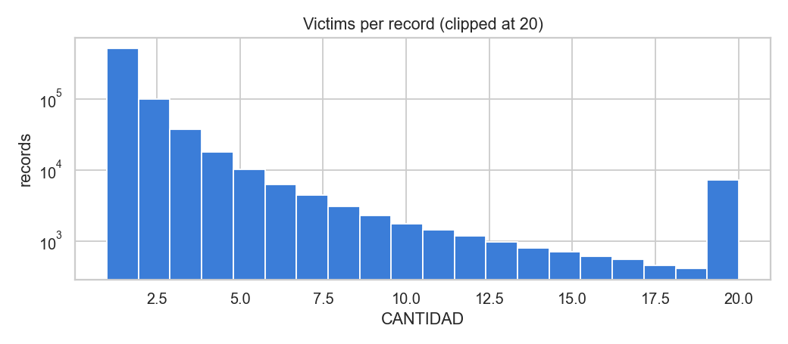
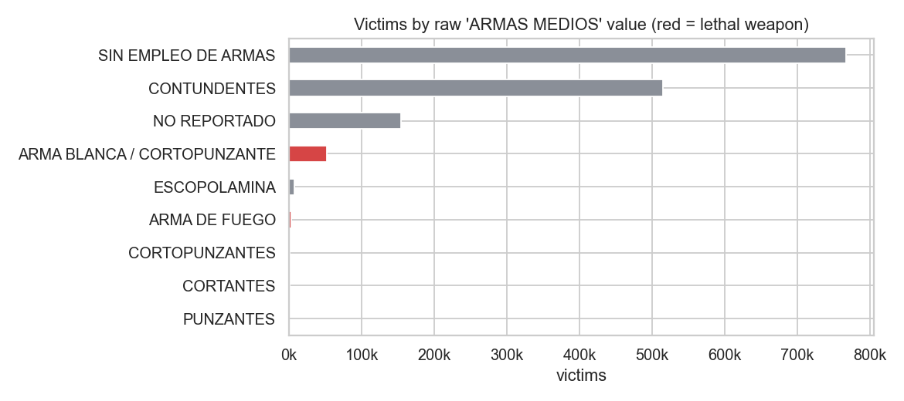
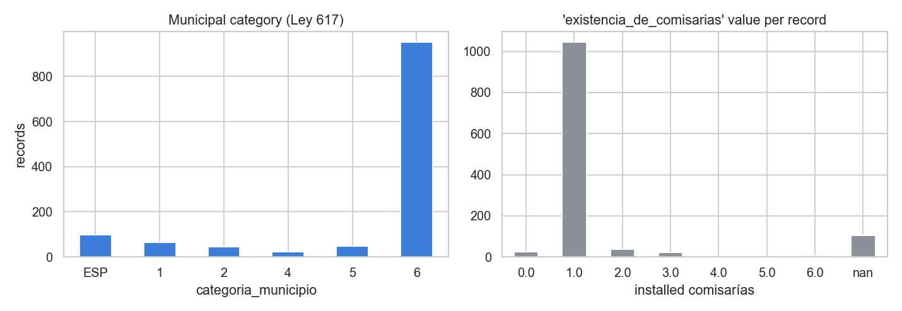
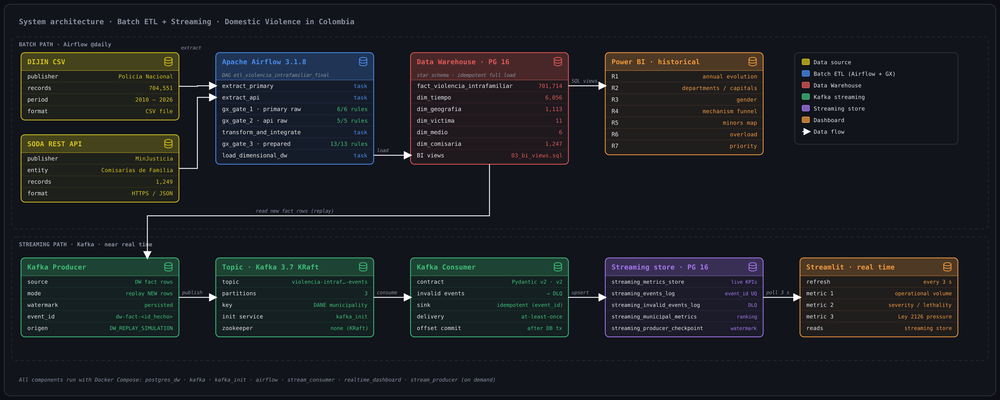
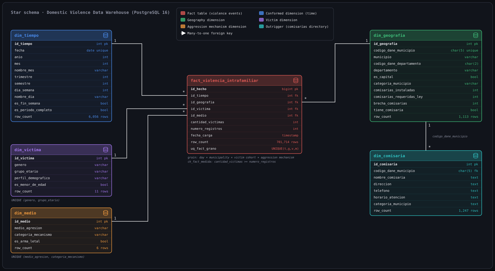
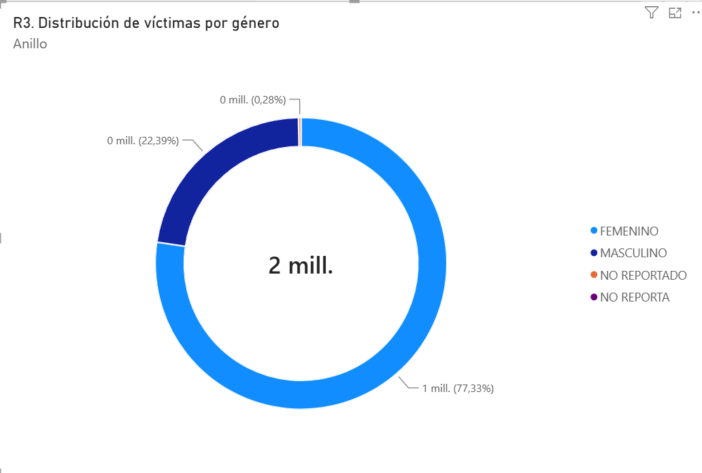
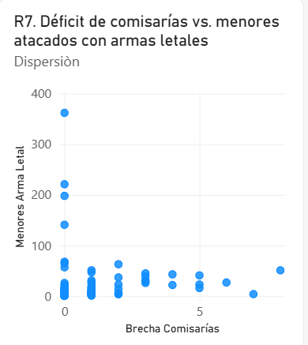
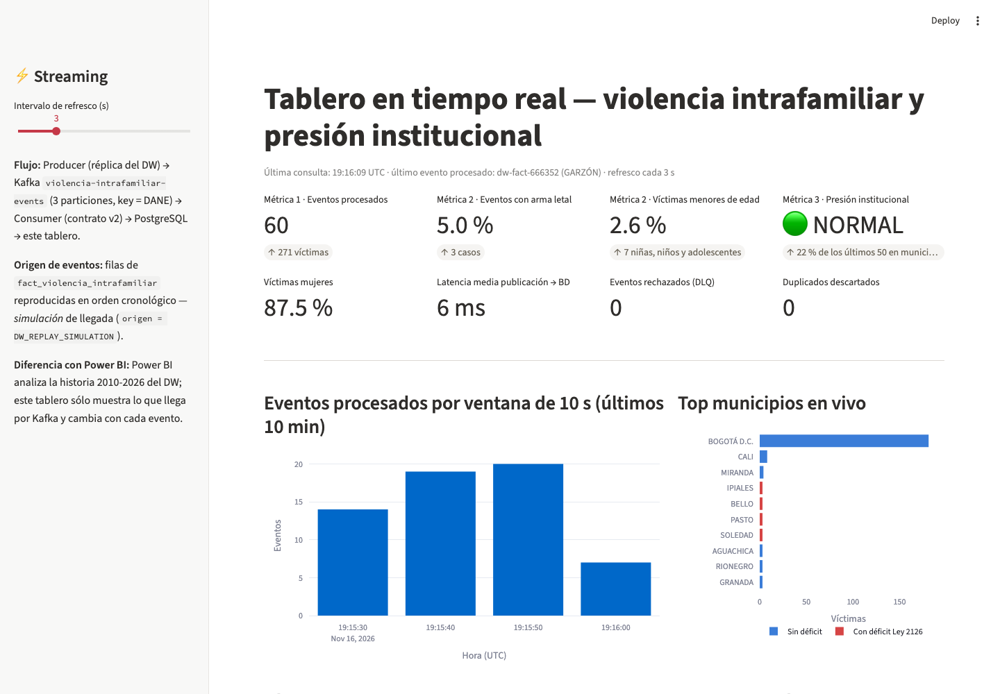
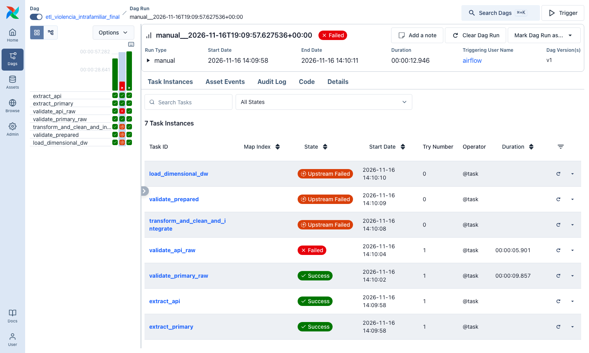

# Domestic Violence in Colombia

## ETL Final Project · Integrated Delivery

**Universidad Autónoma de Occidente (UAO) · Data Engineering and Artificial Intelligence · ETL (G01)**

**Technologies:** Python, Apache Airflow, Great Expectations, PostgreSQL, Apache Kafka, Power BI, and Streamlit
**SDG alignment:** SDG 5, target 5.2 · SDG 16, target 16.1

> This repository brings together and extends the work from the previous deliveries. The final project is incremental: it preserves the historical violence analysis, adds institutional-capacity data, automates the batch pipeline, and demonstrates streaming. It does not replace or modify the previous repositories.

## In simple terms: has the essential work been done?

**Yes: the core components required by the rubric are implemented, and the repository contains evidence of actual executions.** The system extracts two data sources, profiles, cleans and integrates them, validates data quality, loads a dimensional model, addresses historical requirements R1–R7, and demonstrates a Kafka flow with an event contract, metrics, and an updating dashboard.

| Built component | What it means in simple terms |
|---|---|
| Airflow batch ETL | The process of collecting, preparing, and saving data is organized and automated. |
| Three data-quality gates | Data is checked before it reaches the warehouse; a critical failure stops the load. |
| Data Warehouse and Power BI dashboard | Clean data is stored for historical analysis and to answer R1–R7. |
| Kafka, event contract, and DLQ | Events are checked; invalid ones are recorded instead of crashing the consumer. |
| Three streaming metrics and Streamlit dashboard | The demonstration flow shows what is arriving and how its indicators change. |
| Evidence | Reports, screenshots, and saved results cover loads, controlled failures, and resilience experiments. |

**The main items to review before presenting are not missing deliverables.** They are limitations and assumptions that should be explained or improved: DIJIN data may remain cached, streaming is an explicitly documented simulation, R6 compares a historical total with current capacity, and some missing API values are filled with `1`. See [Decisions, limitations, and recommended improvements](#decisions).

## Contents

1. [🎯 Project, objectives, and previous deliveries](#project)
2. [📚 Data sources and EDA](#sources)
3. [🏗️ Architecture](#architecture)
4. [⚙️ Batch ETL with Airflow](#batch)
5. [✅ Data quality with Great Expectations](#quality)
6. [🗄️ Data Warehouse](#warehouse)
7. [📊 Historical analysis R1–R7](#historical)
8. [📨 Streaming with Kafka](#streaming)
9. [📈 Real-time dashboard](#realtime)
10. [▶️ Setup and execution](#execution)
11. [🧾 Functional evidence](#evidence)
12. [🧭 Decisions, limitations, and recommended improvements](#decisions)
13. [🗂️ Repository structure](#structure)

<a id="project"></a>
## 1. 🎯 Project, objectives, and previous deliveries

### The problem this project addresses

National Police reports show how many domestic-violence victims were reported. On their own, they do not explain how much institutional capacity is available to respond. This project therefore combines reports from the National Police (DIJIN) with the Ministry of Justice directory of Family Police Stations (*Comisarías de Familia*).

In simple terms: **one source counts reported incidents; the other describes part of the institutional capacity.** Linking them by the municipality's DANE code makes it possible to explore reported violence alongside the distribution of stations and the gap against the requirement in Law 2126.

### How this project builds on earlier deliveries

- It preserves the DIJIN historical source and requirements **R1–R5** developed earlier.
- It integrates the Ministry of Justice source and adds the institutional analyses **R6 and R7**.
- The final delivery brings those elements together with Airflow, Great Expectations, the Data Warehouse, and a Kafka/Streamlit demonstration.
- The assignment describes the final delivery as incremental. The event flow is explicitly labeled as a simulation; it is not presented as a connection to live police reports.

### Objectives

1. Automate source extraction, transformation, integration, and Data Warehouse loading.
2. Validate data before loading and stop the pipeline when critical rules fail.
3. Answer historical requirements R1–R7 using the Data Warehouse and batch dashboard.
4. Demonstrate event publication and validation, and calculate at least three streaming metrics.
5. Show the metrics in a dashboard that updates as events are processed.

| Objective | Layer |
|---|---|
| O1. Periodically extract both sources, integrate them, and load a dimensional warehouse. | Batch |
| O2. Stop batches that violate critical quality rules and make the failure visible in Airflow. | Batch |
| O3. Answer historical analytical requirements R1–R7 with the Data Warehouse and a BI dashboard. | Batch |
| O4. Publish Data Warehouse facts as Kafka events, validate their contract, and maintain three metrics. | Streaming |
| O5. Show metrics changing as events arrive and demonstrate invalid-event and consumer-outage behavior. | Streaming |

| | Historical batch layer | Low-latency demonstration layer |
|---|---|---|
| Question | What happened, where, and to whom over the historical period? | What is arriving through the event flow, and is it associated with municipalities with a capacity deficit? |
| Main users | Policy and analytical teams | Monitoring and dispatch teams |
| Update | Daily batch schedule; the source itself may be cached (see [limitations](#decisions)). | Producer publishes at a configurable interval; Streamlit refreshes every 3 seconds by default. |
| Data | DIJIN history joined with a MinJusticia snapshot. | Historical Data Warehouse facts replayed as clearly labeled simulated events. |
| Quality controls | Great Expectations gates before loading. | Pydantic event contract, DLQ, and idempotent database sink. |
| Output | Power BI dashboard for R1–R7. | Streamlit dashboard for the three streaming metrics. |

**Why include streaming?** A daily batch cannot show a new event immediately. The replay makes it possible to demonstrate how volume, severity, and institutional-pressure indicators can change shortly after event processing. It is a reproducible demonstration of that architecture, not a live operational alert service.

The full academic instructions are in the [final-delivery rubric PDF](docs/ETL_2026-2_ETLProject_FinalDelivery.pdf).

<a id="sources"></a>
## 2. 📚 Data sources and EDA

### Data sources

| Source | What it contributes | Access and observed size |
|---|---|---|
| National Police – DIJIN, *Reporte Delito Violencia Intrafamiliar* (`vuyt-mqpw`) | Reports, date, municipality, gender, age group, aggression mechanism, and victim count. | [datos.gov.co CSV](https://www.datos.gov.co/api/views/vuyt-mqpw/rows.csv?accessType=DOWNLOAD); 704,551 rows, 8 columns, and 1,501,809 victims. The profiled batch covers 2010-01-01 through 2026-07-31. |
| Ministry of Justice, *Caracterización de las Comisarías de Familia* (`7tuu-upb2`) | Family stations, municipality code, category, and figures associated with Law 2126. | [datos.gov.co SODA REST API](https://www.datos.gov.co/resource/7tuu-upb2.json); 1,249 records, 15 columns, and 1,102 distinct municipal codes. Results are paginated. |

The original inputs are stored in `data/raw/` when extracted, but are not committed to Git; `.gitignore` excludes them. The extraction manifests record file size, columns, hash, and extraction time.

### What profiling found

- `CANTIDAD` is an aggregated measure, so the model preserves both victim counts and the number of source reports.
- The primary source uses `dd/mm/yyyy` dates; 2026 is a partial period in the profiled batch.
- Some API DANE codes have lost their leading zero; they are normalized to five digits before joining.
- Gender, age-group, and API fields contain missing or unreported values. They are retained or imputed according to the transformation and quality rules described below.
- Profiling recorded 1,100 matches between 1,112 municipalities in the primary source and API codes (98.92% by municipality count). Unmatched areas remain in the model; their victims are not discarded.

### EDA and how it informed cleaning

The executed [01_eda_and_profiling.ipynb notebook](notebooks/01_eda_and_profiling.ipynb) analyzes both raw sources, their integration, and the Data Warehouse. Saved visualizations are in `docs/img/`.

| Finding | Implemented decision |
|---|---|
| Missing gender and age-group values | Keep them in explicit `NO REPORTADO` cohorts; do not drop victims. |
| DANE codes with differing lengths and several malformed codes | Normalize the municipal key and document the applied corrections. |
| Multiple labels for bladed weapons | Harmonize labels and derive mechanism categories and a lethal-weapon flag. |
| Multiple Family Police Stations within a municipality | Preserve the directory and roll up institutional capacity to municipality level. |
| Municipalities present in only one source | Use an outer integration, retain records, and expose the matching coverage. |

### EDA-to-implementation traceability

| EDA finding | Implementation decision | Related quality check |
|---|---|---|
| `CANTIDAD` is an aggregated count; observed values are positive and reach 198. | Keep `cantidad_victimas` and `numero_registros` as separate measures; declare the fact grain before aggregation. | DQ-RAW1-04, DQ-PREP-05 |
| Dates use `dd/mm/yyyy`; the latest profiled year is partial. | Parse dates strictly and flag incomplete periods in `dim_tiempo`. | DQ-RAW1-02 |
| DIJIN publishes eight-digit DANE codes; several malformed prefixes require explicit handling. | Roll up to the five-digit municipality code and document known corrections. | DQ-RAW1-03 |
| Weapon descriptions use multiple labels; some mechanisms are not reported. | Harmonize mechanism labels, derive categories and lethality, and retain `NO REPORTADO`. | Prepared-data referential and reconciliation checks |
| Gender and age group contain missing values. | Preserve those reports in an explicit `NO REPORTADO` cohort instead of dropping victims. | DQ-RAW1-05 (warning) |
| The API includes four-digit municipal codes that lost a leading zero. | Apply `zfill(5)` before joining sources. | DQ-RAW2-02 |
| API data is at Family Police Station grain and includes missing or string-valued fields. | Keep a station directory and roll it up to municipality-level capacity; review the explicit imputation assumptions in [Limitations](#decisions). | DQ-RAW2-01, DQ-RAW2-04, DQ-RAW2-05 |
| Not every primary-source municipality has an API match. | Use an outer join and explicit unmatched-area values so primary-source victims remain in the model. | DQ-PREP-06 (warning) |

**EDA figures**

| Historical trend | Daily pattern (2025) | Victims per report |
|---|---|---|
|  |  |  |

| Aggression mechanisms | Demographic profile | Institutional categories |
|---|---|---|
|  |  |  |

<a id="architecture"></a>
## 3. 🏗️ Architecture



The system has two parts:

1. **Batch:** DIJIN and API → extraction and validation → transformation and integration → PostgreSQL Data Warehouse → Power BI.
2. **Streaming demonstration:** Data Warehouse facts → Kafka producer → topic → consumer and event validation → PostgreSQL streaming tables → Streamlit dashboard.

The diagram source is [architecture.mmd](docs/architecture/architecture.mmd). Local services are defined in [docker-compose.yaml](docker-compose.yaml).

<a id="batch"></a>
## 4. ⚙️ Batch ETL with Airflow

The DAG in [etl_violencia_intrafamiliar_dag.py](dags/etl_violencia_intrafamiliar_dag.py) is named `etl_violencia_intrafamiliar_final`. It is scheduled with `@daily`, does not catch up on missed runs, and allows only one active run at a time.

| Step | Task | In simple terms |
|---|---|---|
| 1 | `extract_primary` | Downloads or reuses the DIJIN CSV, calculates SHA-256, and writes a manifest. |
| 2 | `extract_api` | Requests API pages, saves the response, and writes a manifest. |
| 3 | `validate_primary_raw` and `validate_api_raw` | Check each source before the sources are combined. |
| 4 | `transform_and_clean_and_integrate` | Cleans and normalizes DANE codes, integrates the sources, and writes prepared Parquet tables. |
| 5 | `validate_prepared` | Checks the grain, keys, coverage, and measure reconciliation before touching the warehouse. |
| 6 | `load_dimensional_dw` | Reloads the dimensional model in one transaction and compares the result with the source. |

The Airflow graph shows the two extraction and validation branches converging before transformation, prepared-data validation, and loading:


Tasks exchange small references through XCom; larger datasets are stored as files and are not passed through XCom. Network and database tasks have retries; deterministic validation and transformation tasks fail without retries.

The runtime uses Airflow 3.1.8 and PostgreSQL 16. The deployment is intended for a local demonstration; Docker service names and ports are listed in [Setup and execution](#execution).

| Task type | Retry policy | Reason |
|---|---:|---|
| Primary source extraction | 2 retries, 1-minute delay | May recover from transient file or network I/O issues. |
| API extraction | 3 retries, 2-minute delay | May recover from API rate limits, timeouts, or temporary availability issues. |
| Raw/prepared validation and transformation | No retries | Repeating unchanged data and deterministic rules does not fix a data or logic failure. |
| Data Warehouse load | 2 retries, 1-minute delay | May recover from transient database connectivity or lock issues. |

The DAG has three test modes: `TEST_A_SUCCESSFUL_RUN`, `TEST_B_CONTROLLED_FAILURE`, and `TEST_C_SAFE_RERUN`. **Test B removes a mandatory API column and fails at Gate 2.**

> **Caution when rerunning:** the batch load is designed as a full, idempotent reload. Its DDL drops and recreates the Data Warehouse tables inside the transaction. This is not an incremental load that preserves prior warehouse snapshots.

<a id="quality"></a>
## 5. ✅ Data quality with Great Expectations

Declarative rules are in `gx/expectations/`; the runner is [validate_gx.py](src/validate_gx.py). Each gate saves evidence to `docs/evidence/gx_validation_*_latest.json`.

| Gate | Examples of what it checks | What happens if a critical rule fails |
|---|---|---|
| 1. Raw DIJIN | Required columns, date format, DANE code, and positive numeric victim count. | Airflow marks the task as failed and does not run dependent tasks. |
| 2. Raw API | Required fields, municipal-code length, category domain, and Family Police Station values. | Integration and Data Warehouse loading are blocked. |
| 3. Prepared data | Grain uniqueness, foreign keys, relationships to dimensions, and victim/report reconciliation. | Loading is blocked before writing to PostgreSQL. |

The declarative suite rules use stable IDs so their intent can be traced in evidence:

| Rule IDs | Meaning |
|---|---|
| DQ-RAW1-01–05 | DIJIN schema, date format, DANE code, positive numeric measure, and gender completeness warning. |
| DQ-RAW2-01–05 | API schema, municipality code, category-domain warning, non-negative installed count, and completeness warning. |
| DQ-PREP-01–06 | Fact-grain uniqueness, non-null and valid foreign keys, non-negative installed capacity, exact measure reconciliation, and municipal matching coverage warning. |

Warnings are recorded but do not stop the pipeline. This policy distinguishes errors that prevent building the analysis from observations that should remain visible. The evidence from November 16, 2026 records all three gates as passing: 6 results for the primary source, 5 for the API, and 13 for prepared data.

<a id="warehouse"></a>
## 6. 🗄️ Data Warehouse

The schema is defined in [01_create_dw.sql](sql/01_create_dw.sql); analytical views are in [03_bi_views.sql](sql/03_bi_views.sql). PostgreSQL stores one fact table and five dimensions:



- `fact_violencia_intrafamiliar`: victim and source-report measures.
- `dim_tiempo`: calendar and complete-period flag.
- `dim_geografia`: municipality, category, and Family Police Station measures.
- `dim_victima`: gender and age group.
- `dim_medio`: aggression mechanism.
- `dim_comisaria`: Family Police Station directory.

**Fact grain:** one row per day × municipality × demographic cohort × aggression mechanism. Multiple source reports are aggregated into that combination without losing the number of victims or reports.

The fact table's natural grain is enforced with a unique constraint on `(id_tiempo, id_geografia, id_victima, id_medio)`. Dimensions use integer surrogate keys; the geographic dimension also carries the municipality code used for source integration and by the Kafka event key.

| Table | Reported rows |
|---|---:|
| `fact_violencia_intrafamiliar` | 701,714 |
| `dim_tiempo` | 6,056 |
| `dim_geografia` | 1,113 |
| `dim_victima` | 11 |
| `dim_medio` | 6 |
| `dim_comisaria` | 1,247 |

The load evidence records 1,501,809 victims, 704,551 source reports, zero orphan keys, and zero duplicate grain combinations ([reconciliation report](docs/evidence/reconciliation_report.json), [verification query output](docs/evidence/dw_load_check.txt)).

> **Important:** a batch run rebuilds the Data Warehouse tables. The transaction prevents a partial load, but a successful run replaces the previous warehouse contents.

<a id="historical"></a>
## 7. 📊 Historical analysis R1–R7

The Power BI file is [dashboard_historico_violencia.pbix](dashboard/batch/dashboard_historico_violencia.pbix). It connects to PostgreSQL at `localhost:5432`, database `etl_dw`, and uses the Data Warehouse and BI views in *Import* mode, so refresh it after a batch load.

| Req. | Question answered | Documented result |
|---|---|---|
| **R1** | How does reported violence change over time? | From 23,171 victims in 2010 to 138,803 in 2025; 2026 is partial. Growth in 2020 was 1.93%; interpret it with possible under-reporting during that period in mind. |
| **R2** | Where are reports concentrated? | 63.99% of victims are reported in departmental capitals. |
| **R3** | What gender and age profiles appear in the data? | 77.33% of victims are women; 93,986 are children or adolescents. |
| **R4** | Which mechanisms are reported, and which are flagged as lethal? | 51.06% no weapons, 34.31% blunt objects, 10.25% not reported, 3.67% bladed weapons, and 0.22% firearms in the documented cut. |
| **R5** | Which municipalities have reported lethal attacks against minors? | Bogotá (362), Cartagena (221), and Cali (198) are among the highest values shown. |
| **R6** | How many reported victims correspond to each installed Family Police Station? | Cúcuta (20,389), Popayán (17,070), and Bello (16,984), each with one station in the documented cut. **These are cumulative victims compared with currently reported capacity, not an annual rate.** |
| **R7** | Where is there a gap against the Law 2126 requirement? | The dashboard documents a gap of 106 stations in 59 municipalities; Cúcuta has a gap of 8 and Soacha a gap of 6 in the analyzed cut. |

Screenshots for the seven visuals are in `dashboard/batch/` (`r1_...png` through `r7_...png`). Views for overload and intervention priority are defined in `sql/03_bi_views.sql`.

| R1 · Yearly evolution | R2 · Territorial distribution | R3 · Gender and age |
|---|---|---|
|  |  |  |

| R4 · Aggression mechanisms | R5 · Minor victims | R6 · Station workload |
|---|---|---|
|  |  |  |

| R7 · Intervention priority |
|---|
|  |

<a id="streaming"></a>
## 8. 📨 Streaming with Kafka

The project is not connected to a public live feed of police reports. To provide a reproducible streaming demonstration, [producer.py](streaming/producer.py) **replays real Data Warehouse facts as demonstration events**, identified by `origen = "DW_REPLAY_SIMULATION"`. The rubric allows simulated events when their source, frequency, and rationale are documented; they must not be presented as live alerts.

### Topic and delivery settings

| Setting | Value |
|---|---|
| Topic | `violencia-intrafamiliar-events` |
| Broker | Kafka 3.7 in KRaft mode, one local broker |
| Partitions | 3 |
| Event key | Five-digit DANE code; preserves ordering per municipality |
| Retention | 24 hours |
| Delivery | Producer uses `acks=all`; consumer manually commits offsets and writes idempotently to PostgreSQL |

The producer reads facts from the Data Warehouse starting at 2026-01-01 by default, publishes one event per fact row, and saves a *watermark* so later runs can continue. Its default rate is **one event per second**, configurable with `--interval` (for example, `--interval 0.5` for a demo). This demonstrates how indicators could change shortly after a report arrives rather than waiting for the next daily batch. A deterministic `event_id` (`dw-fact-<id_hecho>`) helps discard duplicate deliveries. `--reset` explicitly resets the producer checkpoint.

The topic has three partitions and a replication factor of one because this is a single-broker local demonstration. The consumer group is `etl_streaming_group`; automatic offset commits are disabled. The Kafka key is the municipality's DANE code, so events for that municipality are routed to the same partition.

### Event contract and consumer

The Pydantic v2 contract is in [contract.py](streaming/contract.py). It uses contract version `2.0` and rejects additional fields. It checks the following:

| Field | Contract rule |
|---|---|
| `event_id` | String of 10–64 characters; deterministic for Data Warehouse replay events. |
| `timestamp` | Datetime with a timezone offset; the producer emits UTC. |
| `event_key`, `codigo_dane_municipio` | Exactly five digits and equal to each other. |
| `origen`, `id_hecho_origen` | Source is identified; Data Warehouse replay events must include their source fact ID. |
| Municipality, department, demographic group, and mechanism | Required, non-empty strings with length limits where applicable. |
| `es_menor_de_edad`, `es_arma_letal`, `tiene_deficit_ley_2126` | Required boolean values. |
| `cantidad_victimas` | Integer greater than zero and at most 1,000 per event. |

The documented contract check reports zero violations across 91,754 fact rows from 2025–2026.

The [consumer](streaming/consumer.py) validates each message:

1. Invalid events are recorded in `streaming_invalid_events_log`, the Dead-Letter Queue (DLQ), together with the reason and partition/offset.
2. Valid events are recorded in `streaming_events_log`.
3. Metrics are updated in the same database transaction. If the same `event_id` arrives again, its metrics are not counted twice.
4. The Kafka offset is committed after the PostgreSQL write.
5. If PostgreSQL fails, the transaction is rolled back and the consumer retries the same message instead of intentionally skipping it.

### Streaming metrics

| Metric | What it shows |
|---|---|
| **M1. Operational volume** | Events and victims processed, including women and minor victims. |
| **M2. Severity** | Percentage of events with a lethal weapon and percentage of victims who are minors, calculated from processed event/victim counts. |
| **M3. Institutional pressure** | Percentage of the last 50 events in municipalities with a Family Police Station deficit; `NORMAL` is below 25%, `ALTA` is 25% to below 50%, and `CRITICA` is 50% or above. |

The pipeline also records per-municipality metrics, latency, invalid events, and duplicates. Supporting tables are defined in [02_create_streaming_store.sql](sql/02_create_streaming_store.sql).

<a id="realtime"></a>
## 9. 📈 Real-time dashboard

The [app_realtime.py](dashboard/app_realtime.py) application uses Streamlit and Plotly to query PostgreSQL. The consumer updates PostgreSQL, and the dashboard queries the tables every three seconds by default (configurable from one to ten seconds). In the demonstration, a new event appears after processing and by the next dashboard refresh at the latest.

The dashboard includes the three metrics, recent events, top municipalities, cohort and mechanism breakdowns, latency, and the DLQ. Unlike Power BI, which presents historical data, Streamlit displays what has passed through Kafka since the streaming store was created.

| Before publishing events | After events have been processed |
|---|---|
|  |  |

For a full-page view of the dashboard and its detailed panels, see the [full dashboard screenshot](docs/img/rt_dashboard_full.png).

<a id="execution"></a>
## 10. ▶️ Setup and execution

### Requirements

- Docker Desktop with Docker Compose v2 and enough memory to run Airflow, PostgreSQL, and Kafka.
- Internet access to download DIJIN data and query the API, unless a local cache is used.
- Python 3.11 or later to run the producer, experiments, or notebook from Windows.
- Power BI Desktop to open and refresh the `.pbix` file.

### Configure and start the services

From the repository root in PowerShell:

```powershell
Copy-Item .env.example .env
```

Edit `.env` and replace `DB_PASSWORD` with a local password. Do not share or commit this file. `API_APP_TOKEN` is optional.

```powershell
docker compose build
docker compose up -d
docker compose ps
```

Local services:

| Service | Address |
|---|---|
| Airflow | http://127.0.0.1:8080 |
| Streamlit | http://127.0.0.1:8501 |
| PostgreSQL | `localhost:5432`, database `etl_dw` |
| Kafka from Windows | `127.0.0.1:9092` |

Airflow uses simplified authentication for the local demo. Do not expose these ports to the Internet.

### Run the batch pipeline

The DAG is scheduled daily. It can also be triggered manually:

```powershell
docker exec etl_final_airflow airflow dags trigger etl_violencia_intrafamiliar_final
```

DAG test modes:

```powershell
docker exec etl_final_airflow airflow dags trigger etl_violencia_intrafamiliar_final --conf '{"test_mode":"TEST_B_CONTROLLED_FAILURE"}'
docker exec etl_final_airflow airflow dags trigger etl_violencia_intrafamiliar_final --conf '{"test_mode":"TEST_C_SAFE_RERUN"}'
```

Test B is expected to fail during API validation. Test C runs the full load again and compares totals before and after. To verify the documented result:

```powershell
docker exec etl_final_postgres_dw psql -U postgres -d etl_dw -c "SELECT count(*), sum(cantidad_victimas) FROM fact_violencia_intrafamiliar;"
```

Expected for the documented batch: `701714 | 1501809`.

### Run the streaming demonstration

The consumer starts with Compose. To publish events from Windows:

```powershell
python -m pip install -r requirements.txt
python streaming/producer.py --count 30 --interval 0.5
```

Alternatively, run the producer inside Docker:

```powershell
docker compose run --rm stream_producer --count 30 --interval 0.5
```

To inject invalid events and inspect the DLQ:

```powershell
python streaming/producer.py --count 30 --interval 0.5 --inject-invalid
```

Run resilience experiments while the services are available:

```powershell
python streaming/test_resilience.py --events 10
```

The consumer-interruption experiment stops and restarts the `etl_final_stream_consumer` container. Run it only when that is appropriate for your demonstration.

### Source refresh and persistence

- The API is queried on each normal extraction run. If the query fails, the extractor can use an existing local cache; the manifest records whether that fallback was used.
- The DIJIN CSV is reused by default if it already exists. To attempt a fresh download on each run, change `PRIMARY_FORCE_REFRESH=false` to `PRIMARY_FORCE_REFRESH=true` in `.env`, then recreate the Airflow service so it receives the updated environment (for example, `docker compose up -d --force-recreate airflow`).
- Power BI uses Import mode. Open the file and select **Refresh** after a batch load.

> **Do not remove data by accident:** `docker compose down` stops the services and preserves the volume. `docker compose down -v` also deletes the PostgreSQL volume, including the Data Warehouse and streaming metrics/events. Use it only if you intend to lose that local data. A batch load also replaces the Data Warehouse tables by design.

<a id="evidence"></a>
## 11. 🧾 Functional evidence

The versioned evidence comes from executions documented on November 15 and 16, 2026:

- **Airflow:** DAG and successful/failed run screenshots in `docs/img/airflow_*.png`.
- **Controlled failure:** [test_b_controlled_failure.json](docs/evidence/test_b_controlled_failure.json) and screenshots showing downstream tasks blocked.
- **Load and reconciliation:** [reconciliation_report.json](docs/evidence/reconciliation_report.json) and [dw_load_check.txt](docs/evidence/dw_load_check.txt).
- **Validation:** [primary gate](docs/evidence/gx_validation_primary_raw_latest.json), [API gate](docs/evidence/gx_validation_api_raw_latest.json), and [prepared-data gate](docs/evidence/gx_validation_prepared_latest.json).
- **Batch runs A and C:** [successful run](docs/evidence/test_a_successful_run.json) and [idempotent rerun](docs/evidence/test_c_safe_rerun.json).
- **Invalid events and DLQ:** [Experiment 1](docs/evidence/streaming_experiment_1.json).
- **Consumer interruption and recovery:** [Experiment 2](docs/evidence/streaming_experiment_2.json).
- **Duplicate delivery:** [Experiment 3](docs/evidence/streaming_experiment_3.json).
- **Dashboard:** before/after screenshots in `docs/img/rt_dashboard_*.png`.

These are saved results, not a guarantee that containers are currently running. Start the application to repeat the demonstration.

### Airflow execution screenshots

| Successful end-to-end run | Controlled failure and blocked downstream tasks |
|---|---|
|  |  |

The [Gate 2 task log](docs/img/airflow_gate2_failure_log.png) shows the injected missing API field and the resulting validation failure. The [Airflow DAG grid](docs/img/airflow_dag_grid.png) provides another view of task states across runs.

### Recorded test outcomes

| Test | Recorded outcome |
|---|---|
| Test A — successful batch | Passed end to end; 704,551 source records and 1,501,809 victims reconciled exactly, with zero orphan keys. |
| Test B — controlled quality failure | Passed the blocking test: Gate 2 rejected the missing API field, and all three downstream tasks were blocked. |
| Test C — safe rerun | Passed; a second load produced zero changes in fact rows, victims, source records, or dimension counts. |
| Streaming Experiment 1 — invalid events | Passed; two invalid messages were written to the DLQ and the consumer remained alive. |
| Streaming Experiment 2 — consumer interruption | Passed; ten queued events were processed after restart and Kafka lag returned to zero in 3.2 seconds. |
| Streaming Experiment 3 — duplicate delivery | Passed; the duplicate count increased by one while event and victim totals remained unchanged. |

<a id="decisions"></a>
## 12. 🧭 Decisions, limitations, and recommended improvements

### Prototype limitations

1. **Simulated streaming:** events come from the Data Warehouse, not a live police-reporting service. This is an intentional, documented limitation; the rubric allows simulated event arrival if its strategy and low-latency rationale are explained.
2. **Kafka capacity:** the project uses one broker and replication factor 1. That is sufficient for a local demonstration, not for fault tolerance in production.
3. **R6 is cumulative:** the view compares victims across the full historical series with the current number of Family Police Stations. Do not interpret it as annual workload or historical capacity by year.
4. **Missing institutional data:** some capacity values are filled with `1`. This can affect the legal gap and should be examined before presenting R6/R7 as exact measurements.
5. **DIJIN refresh:** `PRIMARY_FORCE_REFRESH` defaults to `false`. A daily DAG may process the same local file again; “daily” does not necessarily mean “new data every day.”
6. **Manifest date range:** profiling records data through 2026-07-31, but the primary manifest may report 31/12/2025 because the extractor compares date strings as text. Parse the dates before using this field as the official range.
7. **Power BI:** the file is a desktop report in Import mode and requires a manual refresh after a load. Power BI Desktop is needed for the interactive report.
8. **Data and refreshes:** input CSV/JSON files are not versioned. Runs depend on datos.gov.co being available or on a local cache.

### Security and data handling

- Do not commit passwords, tokens, or `.env` files. `.env` is excluded by `.gitignore`; Compose requires `DB_PASSWORD`.
- Airflow, PostgreSQL, Kafka, and Streamlit ports are bound to `127.0.0.1` for the local demonstration.
- Airflow uses simplified demo authentication and Kafka uses PLAINTEXT. Do not expose this setup to a public or shared network.
- Before deploying, review which Family Police Station contact details are necessary and who should be able to access them.

### What to improve first

1. **Data freshness:** decide when DIJIN should be downloaded again and how old a cache may be; expose that status in the DAG run.
2. **Date manifest:** parse `FECHA HECHO` as dates and store chronological minimum/maximum values.
3. **API assumptions:** retain missing values as unknown or make the imputation explicit, and report how many municipalities are affected.
4. **R6:** add an annual or recent-period metric and keep the cumulative figure separate.
5. **Automated tests:** add focused tests for cleaning, keys, imputations, and producer/consumer rules. The current resilience tests are integration tests and require Docker.
6. **Reproducible environment:** pin compatible dependency versions and add automated repository checks.

<a id="structure"></a>
## 13. 🗂️ Repository structure

```text
.
├── dags/                 # Airflow batch orchestration
├── src/                  # Extraction, profiling, transformation, GX, and loading
├── gx/                   # Suites, checkpoints, and validation definitions
├── sql/                  # Data Warehouse, streaming store, and BI views
├── streaming/            # Contract, producer, consumer, and experiments
├── dashboard/
│   ├── app_realtime.py   # Streamlit dashboard
│   └── batch/            # Power BI report and R1–R7 screenshots
├── notebooks/            # EDA and reproducible profiling
├── data/raw/             # Manifests; raw inputs are excluded from Git
└── docs/
    ├── architecture/     # Editable architecture diagram source
    ├── evidence/         # Test results and reconciliation evidence
    └── img/              # Architecture/star-schema diagrams, EDA, and screenshots
```

The implementation, dependencies, and local configuration are in [requirements.txt](requirements.txt), [Dockerfile](Dockerfile), [docker-compose.yaml](docker-compose.yaml), [`.env.example`](.env.example), and [.gitignore](.gitignore).
