# Domestic Violence in Colombia — Batch + Streaming Analytical System
### ETL (G01) · Final Delivery · Airflow + Great Expectations + PostgreSQL DW + Apache Kafka + Power BI + Streamlit

**Faculty:** Faculty of Engineering and Basic Sciences · **Program:** Data Engineering and Artificial Intelligence
**Institution:** Universidad Autónoma de Occidente (UAO)
**SDG alignment:** SDG 5 (target 5.2) and SDG 16 (target 16.1)

**Team:** Michael Macowli Cardona Rodríguez · Sebastián Manrique Mejía · Sebastián Torres Pantoja · David Hernández Paz

> This repository is the **integrated final version** of the project. It extends (does not replace) the
> repositories of Delivery 1 and Delivery 2.

---

## Table of contents
1. [Project overview and objectives](#1-project-overview-and-objectives)
2. [Data sources and EDA](#2-data-sources-and-eda)
3. [System architecture](#3-system-architecture)
4. [Batch ETL pipeline (Airflow)](#4-batch-etl-pipeline-airflow)
5. [Data quality (Great Expectations)](#5-data-quality-great-expectations)
6. [Data Warehouse](#6-data-warehouse)
7. [Batch analytical dashboard (Power BI)](#7-batch-analytical-dashboard-power-bi)
8. [Streaming pipeline (Kafka)](#8-streaming-pipeline-kafka)
9. [Real-time dashboard (Streamlit)](#9-real-time-dashboard-streamlit)
10. [Execution and reproducibility](#10-execution-and-reproducibility)
11. [Functional evidence](#11-functional-evidence)
12. [Engineering decisions and limitations](#12-engineering-decisions-and-limitations)
13. [Objectives achieved](#13-objectives-achieved)
14. [Repository structure](#14-repository-structure)

---

## 1. Project overview and objectives

### 1.1 Problem
Police reports of domestic violence in Colombia grew from **23,171 victims in 2010 to 138,803 in 2025**
(Policía Nacional – DIJIN). Reported volume alone does not say *where the State lacks capacity to respond*.
Ley 2126 de 2021 requires municipalities to have Comisarías de Familia in proportion to their population, so we
integrate the DIJIN reports with the national directory of Comisarías de Familia (MinJusticia, SODA API) to relate
violence to institutional capacity.

**Why this pipeline?** To give public-policy analysts (batch) and a monitoring room (low latency) a single,
validated source of truth that combines *how much violence there is* with *how much capacity exists to attend it*.

### 1.2 Refined objectives

| # | Objective | Type |
|---|---|---|
| O1 | Automate, with Airflow, the periodic extraction of both sources, their cleaning/integration and the load of a star-schema DW. | Batch |
| O2 | Block with Great Expectations any batch that violates critical quality rules before it reaches the DW, and make the failure visible in Airflow. | Batch |
| O3 | Answer the historical analytical requirements **R1–R7** in a BI dashboard connected to the DW. | Batch |
| O4 | Publish new DW facts as Kafka events, validate them with an event contract and maintain **3 streaming metrics** with low latency. | Streaming |
| O5 | Show those metrics in a dashboard that changes visibly as events arrive, and prove the behaviour with invalid events and a consumer outage. | Streaming |

Historical requirements (batch): **R1** yearly evolution · **R2** territorial concentration · **R3** gender and age
vulnerability · **R4** aggression mechanism and lethality · **R5** lethal attacks on minors by municipality ·
**R6** overload of existing comisarías (victims per comisaría) · **R7** Ley 2126 deficit and intervention priority.

### 1.3 Batch vs. low-latency requirements

| | Batch analytical layer | Low-latency streaming layer |
|---|---|---|
| Question | *What happened, where and to whom (2010–2026)?* | *What is arriving right now and is it hitting municipalities without enough comisarías?* |
| Users | Policy analysts, ministries | Monitoring / dispatch room |
| Latency | Daily (`@daily` DAG, ~1 min run) | Seconds (event → PostgreSQL in ~10–30 ms; dashboard refresh 3 s) |
| Data | Full DIJIN history + API snapshot | New fact rows replayed as events (simulation, see §8.2) |
| Quality control | 3 Great Expectations gates | Pydantic event contract + Dead-Letter Queue + idempotent sink |
| Output | Power BI (R1–R7) | Streamlit live dashboard |

**Value of the streaming component.** The DW holds ~150 fact rows and ~380 victims **per day** with strong peaks
(EDA §S1). With a daily batch, a surge of incidents in municipalities that already lack comisarías (e.g. Cúcuta,
1 installed vs. 9 required) is only visible the next day. The streaming layer updates the volume, severity and
institutional-pressure metrics within seconds of each report, which is what an operational room needs to reallocate
staff or escalate cases.

---

## 2. Data sources and EDA

### 2.1 Sources

| | Static dataset | Dynamic API |
|---|---|---|
| Provider | Policía Nacional – DIJIN | Ministerio de Justicia y del Derecho |
| Dataset | *Reporte Delito Violencia Intrafamiliar* (`vuyt-mqpw`) | *Caracterización de las Comisarías de Familia* (`7tuu-upb2`) |
| Access | CSV download from datos.gov.co, SHA-256 manifest (`data/raw/primary_source_manifest.json`) | SODA REST API, paginated (`$limit=2000`, `$offset`, `$order=:id`), retries with back-off, cache fallback |
| Size | 704,551 rows · 8 columns · 1,501,809 victims · 2010-01-01 → 2026-07-31 | 1,249 records · 15 columns · 1,102 municipalities |
| Refresh | Re-published periodically; re-downloaded when `PRIMARY_FORCE_REFRESH=true` | Queried live on every DAG run |

**Streaming events.** There is no public real-time feed of police reports, so events are generated by replaying
the DW fact table chronologically (one event per new fact row). This is explicitly a **simulation** of event
arrival — every event carries `origen = "DW_REPLAY_SIMULATION"` and the original incident date (`fecha_hecho`).
They require lower latency because they represent incidents an operational room must react to the same day (§1.3).

### 2.2 EDA

Notebook: [`notebooks/01_eda_and_profiling.ipynb`](notebooks/01_eda_and_profiling.ipynb) (executed, with outputs).
It profiles **both raw sources**, the cross-source join and the loaded DW.

| | |
|---|---|
| 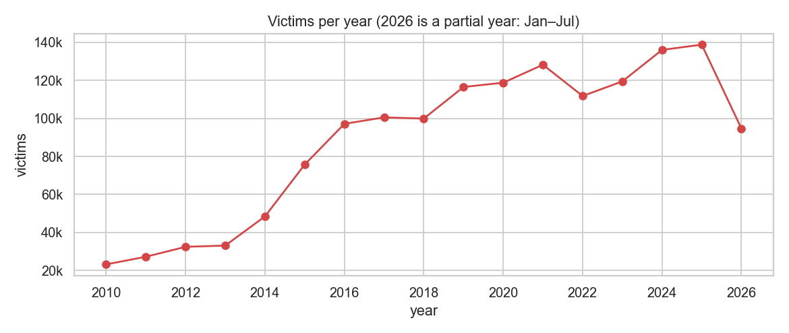 |  |
| 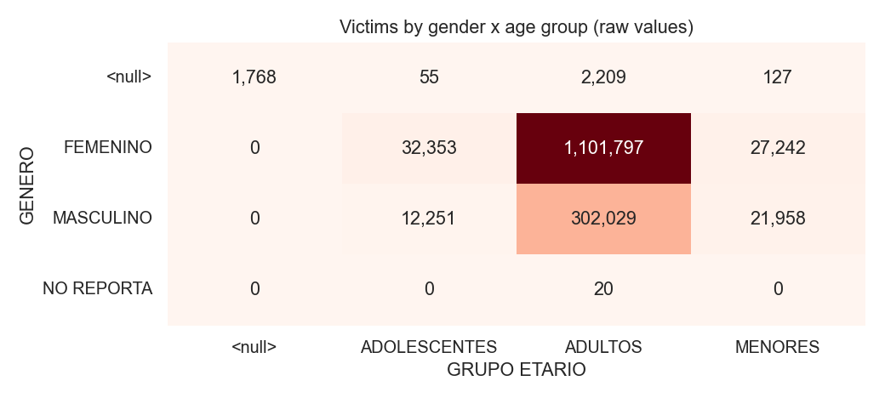 |  |

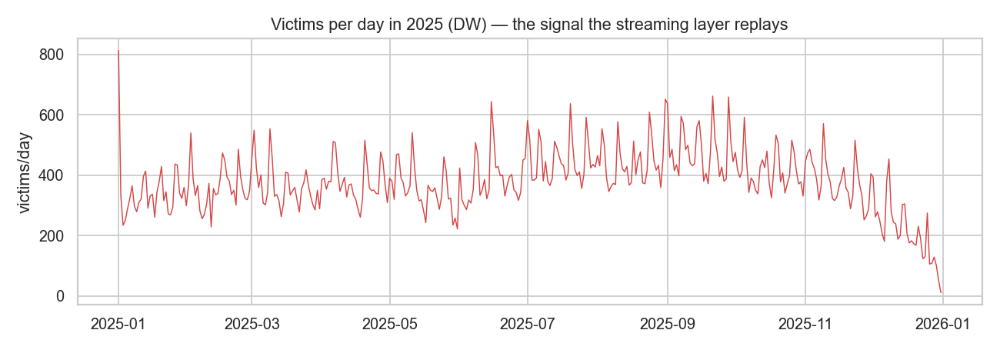

### 2.3 How EDA findings drove cleaning, transformation and quality rules

| # | Finding (raw data) | Decision implemented (`src/transform_and_integrate.py`, `src/dimensional_model.py`) | GX rule |
|---|---|---|---|
| P1 | `CANTIDAD` is an aggregated count, always ≥ 1, median 1, max 198 | Two measures: `cantidad_victimas` and `numero_registros`; declared fact grain | DQ-RAW1-04 (critical), DQ-PREP-05 (critical) |
| P2 | Dates `dd/mm/yyyy`; 2026 only Jan–Jul | Strict parsing; `dim_tiempo.es_periodo_completo` flags partial periods | DQ-RAW1-02 (critical) |
| P3 | 8-digit DANE code; 6 rows with invalid `00000`/`52000`; `(CT)` capital marker in 39 % of rows | Roll-up to 5-digit `DDMMM`; remap invalid codes; derive `es_capital`; modal name per code | DQ-RAW1-03 (critical) |
| P4 | Bladed weapons under 4 labels; 10.3 % of victims with `NO REPORTADO` mechanism | Harmonised `medio_agresion`, `categoria_mecanismo`, `es_arma_letal` (bladed + firearm); `NO REPORTADO` kept explicit | DQ-PREP-03 (critical FK) |
| P5 | 3,379 null genders, 1,406 null age groups | Explicit `NO REPORTADO` cohort (no victim dropped); `es_menor_de_edad` | DQ-RAW1-05 (warning) |
| A1 | 194 API codes lost the leading zero (`5088`) | `zfill(5)` before joining | DQ-RAW2-02 (critical) |
| A2 | API at comisaría grain, literal `'Null'` strings, 24 rows with 0 comisarías | `dim_comisaria` outrigger; municipal roll-up with installed / required / gap | DQ-RAW2-01, DQ-RAW2-04 (critical) |
| I1 | After padding, 1,100 of 1,111 DIJIN municipalities match the API (99.85 % of victims) | Full outer join + explicit defaults for non-municipalised areas | DQ-PREP-06 (warning) |
| S1 | ~150 fact rows / ~380 victims per day with peaks | Streaming replay + 3 live metrics | Event contract v2 + DLQ |

---

## 3. System architecture

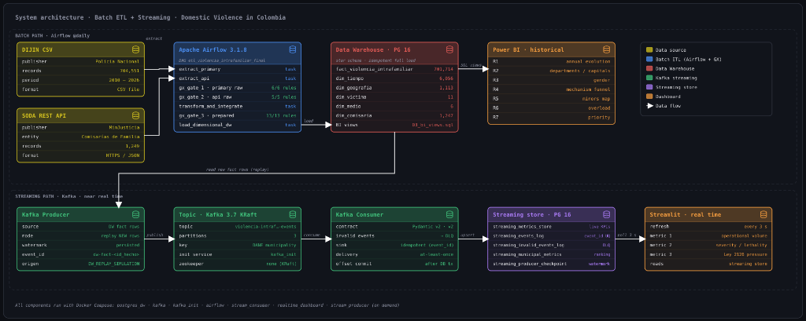

Source of the diagram: [`imagenes/arquitectura_sistema.png`](imagenes/arquitectura_sistema.png) (Mermaid source also available in [`docs/architecture/architecture.mmd`](docs/architecture/architecture.mmd)).
It follows the recommended architecture of the assignment: two sources → Airflow (extract → GX → transform → GX →
load) → PostgreSQL DW → Power BI; DW → Kafka producer → topic → consumer → streaming tables → real-time dashboard.
All components run with Docker Compose (`postgres_dw`, `kafka`, `kafka_init`, `airflow`, `stream_consumer`,
`realtime_dashboard`, on-demand `stream_producer`).

---

## 4. Batch ETL pipeline (Airflow)

DAG [`dags/etl_violencia_intrafamiliar_dag.py`](dags/etl_violencia_intrafamiliar_dag.py) —
`dag_id = etl_violencia_intrafamiliar_final`, Airflow **3.1.8** TaskFlow API, `schedule="@daily"`, `catchup=False`,
`max_active_runs=1`.

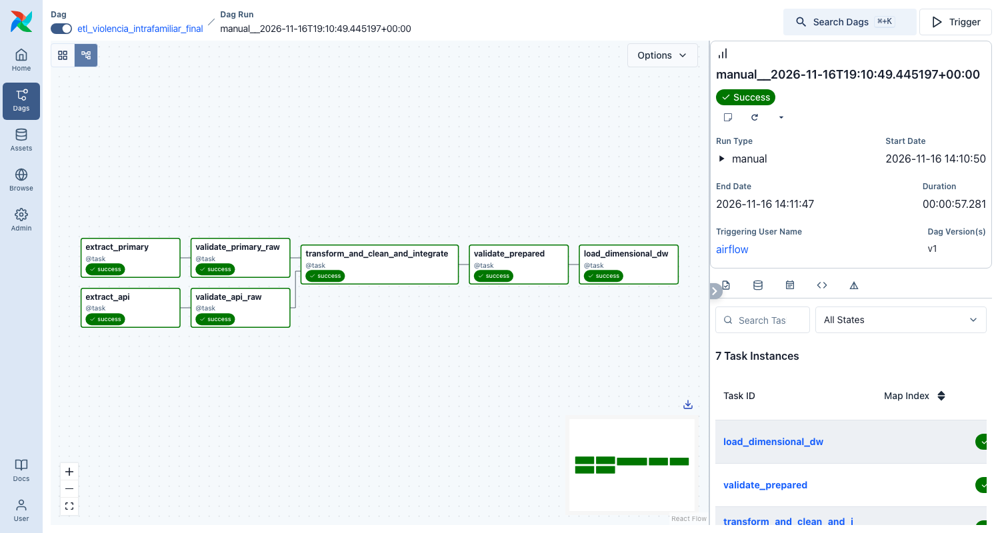

| Order | Task | What it does | Retries |
|---|---|---|---|
| 1a | `extract_primary` | Loads/downloads the DIJIN CSV (all columns as text to keep leading zeros), SHA-256, manifest | 2 × 1 min (I/O) |
| 1b | `extract_api` | Paginates the SODA API, persists `data/raw/api_comisarias_raw.json`, manifest | 3 × 2 min (HTTP 429/timeouts) |
| 2a | `validate_primary_raw` | **GX gate 1** on the raw CSV | 0 (deterministic) |
| 2b | `validate_api_raw` | **GX gate 2** on the raw API batch | 0 |
| 3 | `transform_and_clean_and_integrate` | Cleaning (§2.3), integration on the 5-digit DANE key, star-schema build, Parquet in `data/processed/` | 0 |
| 4 | `validate_prepared` | **GX gate 3**: grain uniqueness, FK integrity, exact reconciliation of victims and records | 0 |
| 5 | `load_dimensional_dw` | Single transaction: DDL (`sql/01_create_dw.sql`) → `COPY` of 5 dims + fact → BI views (`sql/03_bi_views.sql`) → post-load reconciliation (`docs/evidence/reconciliation_report.json`) | 2 × 1 min (DB) |

Only small manifests (paths, counts, hashes) travel through XCom; data is exchanged as files.
A `test_mode` parameter (UI → *Trigger* → params) runs the three reliability scenarios:
`TEST_A_SUCCESSFUL_RUN`, `TEST_B_CONTROLLED_FAILURE` (drops a mandatory API column before gate 2) and
`TEST_C_SAFE_RERUN` (idempotent reload).

---

## 5. Data quality (Great Expectations)

Suites in [`gx/expectations/`](gx/expectations), checkpoints and validation definitions in [`gx/`](gx),
runner in [`src/validate_gx.py`](src/validate_gx.py) (GX 1.x, ephemeral context). Each gate writes its result to
`docs/evidence/gx_validation_<gate>_latest.json`.

| Gate | Rule | Expectation | Severity |
|---|---|---|---|
| 1 · primary raw | DQ-RAW1-01 | the 8 mandatory columns exist | Critical |
| | DQ-RAW1-02 | `FECHA HECHO` matches `dd/mm/yyyy` | Critical |
| | DQ-RAW1-03 | `CODIGO DANE` has exactly 8 digits | Critical |
| | DQ-RAW1-04 | `CANTIDAD` numeric, not null, ≥ 1 | Critical |
| | DQ-RAW1-05 | `GENERO` not null (mostly 0.99) | Warning |
| 2 · API raw | DQ-RAW2-01 | DANE code, category, `existencia_de_comisarias`, Ley 2126 target exist | Critical |
| | DQ-RAW2-02 | municipality code length 4–5 | Critical |
| | DQ-RAW2-03 | category in {ESP, 1–6} (mostly 0.98) | Warning |
| | DQ-RAW2-04 | installed comisarías ≥ 0 | Critical |
| | DQ-RAW2-05 | `existencia_de_comisarias` not null (mostly 0.9) | Warning |
| 3 · prepared | DQ-PREP-01 | fact grain `(tiempo, geografía, víctima, medio)` unique | Critical |
| | DQ-PREP-02/03 | FKs not null and present in each dimension | Critical |
| | DQ-PREP-04 | `comisarias_instaladas` ≥ 0 | Critical |
| | DQ-PREP-05 | Σ victims = 1,501,809 and Σ records = 704,551 (exact reconciliation with the source) | Critical |
| | DQ-PREP-06 | non-municipalised areas ≤ 2 % | Warning |

**Latest results (Airflow run of 2026-11-16):** gate 1 → 6/6 rules passed, gate 2 → 5/5, gate 3 → 13/13.

**Behaviour on a critical failure.** The gate raises `AirflowFailException` (no retries); the task turns red and
every downstream task becomes `upstream_failed`, so **nothing is written to the DW** (the load also runs inside a
single transaction that is rolled back on any error). Warnings are logged and recorded in the evidence JSON but do
not stop the run. See the real Test B run in §11.2.

---

## 6. Data Warehouse

DDL: [`sql/01_create_dw.sql`](sql/01_create_dw.sql) · BI views: [`sql/03_bi_views.sql`](sql/03_bi_views.sql) ·
streaming store: [`sql/02_create_streaming_store.sql`](sql/02_create_streaming_store.sql). PostgreSQL 16.

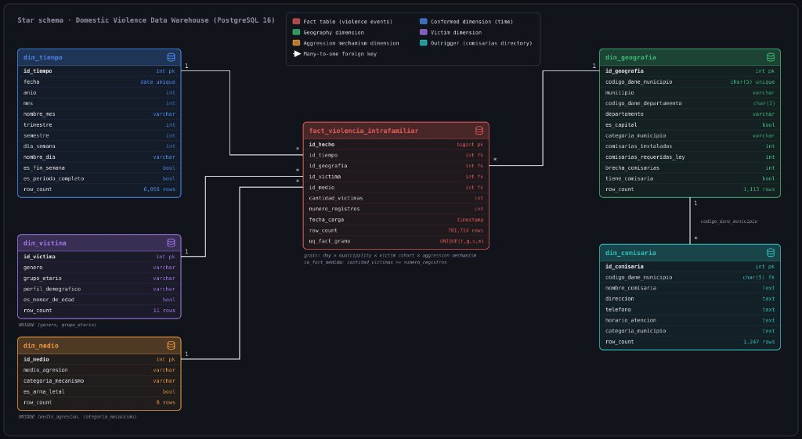

* **Grain:** one row per *day × municipality × victim cohort (gender, age group) × aggression mechanism*
  (`UNIQUE uq_fact_grano`). 704,551 source records collapse to 701,714 fact rows with **all victims preserved**.
* **Dimensions:** `dim_tiempo` (dense calendar), `dim_geografia` (municipality + Ley 617 category + Ley 2126 installed /
  required / gap), `dim_victima`, `dim_medio`, `dim_comisaria` (outrigger directory of 1,247 comisarías).
* **Loading strategy:** full, idempotent reload in one transaction (drop/create → `COPY` → views → reconciliation).
  Re-running the DAG produces the same counts and zero duplicates (Test C). The source is a full snapshot, so a full
  reload is simpler and safer than incremental merges at this volume (~1 min).

Loaded tables (real query output, [`docs/evidence/dw_load_check.txt`](docs/evidence/dw_load_check.txt)):

```text
            tabla             | filas  | victimas | registros
------------------------------+--------+----------+-----------
 fact_violencia_intrafamiliar | 701714 |  1501809 |    704551
 dim_tiempo                   |   6056 |          |
 dim_geografia                |   1113 |          |
 dim_victima                  |     11 |          |
 dim_medio                    |      6 |          |
 dim_comisaria                |   1247 |          |
 huerfanos_geo = 0 | duplicados_grano = 0
```

---

## 7. Batch analytical dashboard (Power BI)

File: [`dashboard/batch/dashboard_historico_violencia.pbix`](dashboard/batch/dashboard_historico_violencia.pbix).
It connects with the **PostgreSQL connector** (Get Data → PostgreSQL → `localhost:5432`, database `etl_dw`, import
mode) to `fact_violencia_intrafamiliar`, the four dimensions and the views `vw_r6_sobrecarga_comisarias` and
`vw_r7_prioridad_intervencion`. After a DAG run, *Refresh* pulls the new DW state.

| Req. | Visual | Main insight (DW values) |
|---|---|---|
| R1 | Yearly line | 23,171 victims (2010) → 138,803 (2025), ×6; 2020 grew only +1.93 % (lockdown under-reporting); 2026 is partial. |
| R2 | Departments / capitals | **63.99 %** of victims are reported in department capitals. |
| R3 | Gender and age | **77.33 %** of victims are women (1,161,392); **93,986** are children or adolescents. |
| R4 | Mechanism funnel | 51.06 % without weapons, 34.31 % blunt objects, 10.25 % not reported, 3.67 % bladed, 0.22 % firearms. |
| R5 | Map of minors attacked with lethal weapons | Highest counts: Bogotá (362), Cartagena (221), Cali (198). |
| R6 | Victims per installed comisaría | Cúcuta 20,389, Popayán 17,070, Bello 16,984 victims per single comisaría; 59 municipalities in critical overload. |
| R7 | Ley 2126 gap and priority | **106** missing comisarías in **59** municipalities; largest gaps Cúcuta (8), Soacha (6), Bello / Soledad / Montería (5). |

| | | |
|---|---|---|
| 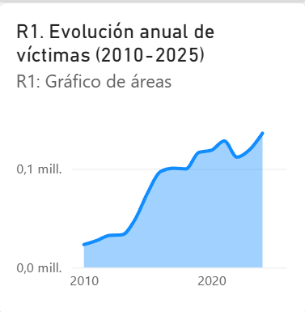 | 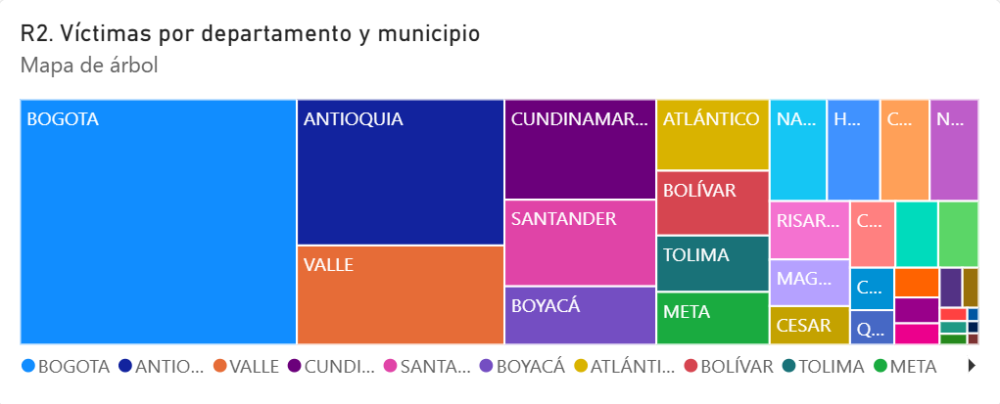 |  |
| 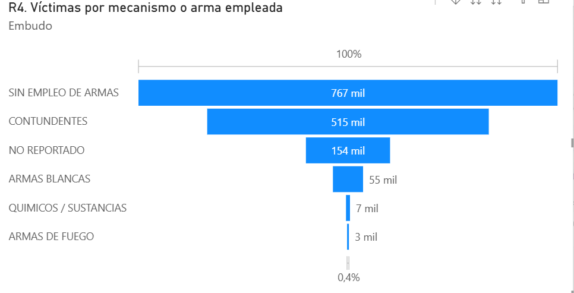 | 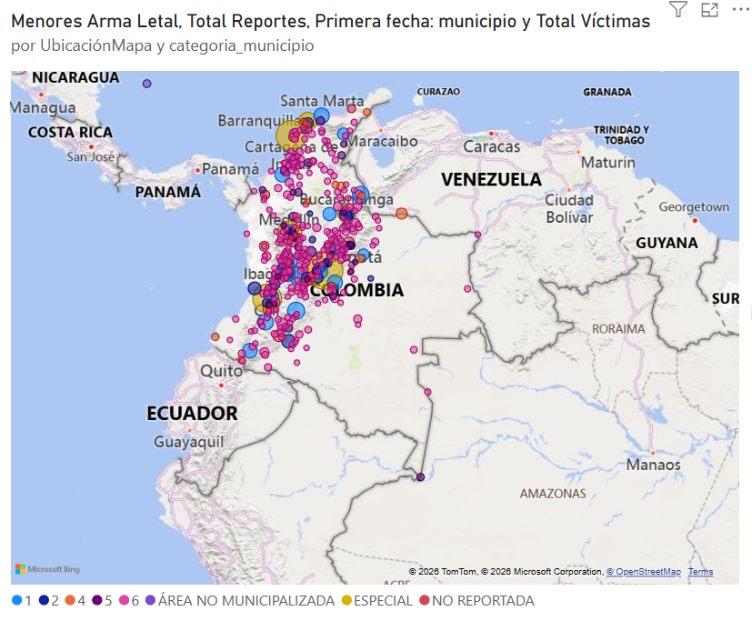 | 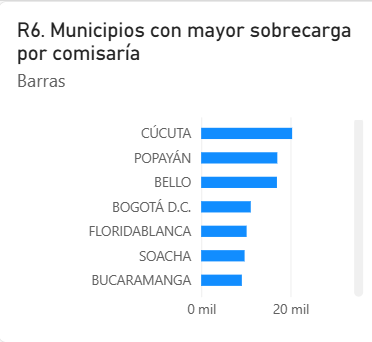 |
|  | | |

---

## 8. Streaming pipeline (Kafka)

### 8.1 Topic configuration
Apache Kafka 3.7 in KRaft mode (no ZooKeeper). The `kafka_init` service creates the topic explicitly
(automatic topic creation is disabled):

| Setting | Value | Reason |
|---|---|---|
| Topic | `violencia-intrafamiliar-events` | one business stream |
| Partitions | 3 | parallelism; ordering per municipality is enough |
| Key | 5-digit DANE municipality code | all events of a municipality go to the same partition (ordered) |
| Replication | 1 | single local broker (see limitations) |
| Retention | 24 h (`retention.ms=86400000`) | enough to replay a consumer outage |
| Producer | `acks=all`, `retries=5`, synchronous send per event | no silent loss |
| Consumer group | `etl_streaming_group`, `auto_offset_reset=earliest`, manual commit | at-least-once |

### 8.2 Event generation — producer ([`streaming/producer.py`](streaming/producer.py))
* Reads `fact_violencia_intrafamiliar` joined with its dimensions **in chronological order** (`fecha`; within a day
  a deterministic pseudo-random order so municipalities interleave) and publishes **one event per fact row**.
  Default start: 2026-01-01 (the most recent period in the DW).
* **No repeated publications:** a watermark (`fecha`, order, `id_hecho`) is stored in
  `streaming_producer_checkpoint` after each delivered event; the next run continues after it. `--reset` restarts
  explicitly. `event_id = dw-fact-<id_hecho>` is deterministic, so even a forced replay is de-duplicated downstream.
* **Rate:** `--interval` seconds between events (default 1 s; 0.2–0.5 s in the demos).
* It is a **simulation of arrival** of historical records (`origen = DW_REPLAY_SIMULATION`).

### 8.3 Event contract v2 ([`streaming/contract.py`](streaming/contract.py), Pydantic v2, `extra="forbid"`)

| Field | Type | Rule |
|---|---|---|
| `contract_version` | `"2.0"` | literal |
| `event_id` | str 10–64 | **event identifier**, unique |
| `timestamp` | datetime with offset | **event timestamp** (UTC publication time) |
| `event_key` | str(5) digits | **event key** = Kafka key = `codigo_dane_municipio` |
| `origen` | `DW_REPLAY_SIMULATION` \| `TEST_INJECTION` | provenance; DW replays must carry `id_hecho_origen` |
| `id_hecho_origen` | int ≥ 1, optional | source fact row |
| `fecha_hecho` | date | incident date in the DW |
| `codigo_dane_municipio`, `municipio`, `departamento` | str | 5 digits / 2–150 / 2–100 chars |
| `genero` | str | FEMENINO, MASCULINO, NO REPORTA, NO REPORTADO, OTRO |
| `grupo_etario`, `medio_agresion`, `categoria_municipio` | str | non-empty |
| `es_menor_de_edad`, `es_arma_letal`, `tiene_deficit_ley_2126` | bool | required |
| `cantidad_victimas` | int | 1 ≤ x ≤ 1000 |

All 91,754 fact rows of 2025–2026 were checked against the contract with 0 violations.

### 8.4 Consumer ([`streaming/consumer.py`](streaming/consumer.py))
1. Deserialises and validates each message. Invalid JSON or contract violations go to the **Dead-Letter Queue**
   table `streaming_invalid_events_log` (raw payload, reason, partition, offset) and the offset is committed, so a
   poison pill never blocks the partition.
2. Inserts the event into `streaming_events_log` (`event_id UNIQUE`). If it already exists the message is counted as
   a duplicate and **metrics are not touched** (idempotent sink).
3. Updates the metrics **in the same DB transaction**, then commits the Kafka offset (at-least-once delivery +
   idempotent sink ⇒ metrics counted once). If PostgreSQL fails, it rolls back, reconnects and retries the same
   message instead of skipping it.

### 8.5 Streaming metrics (table `streaming_metrics_store`)

| Metric | Definition | Why it matters in real time |
|---|---|---|
| **M1 · Operational volume** | events processed, victims, women victims, minor victims | workload arriving at the monitoring room |
| **M2 · Severity** | % of events with a lethal weapon (bladed/firearm); % of victims who are minors | cases that need immediate escalation |
| **M3 · Institutional pressure** | % of the **last 50 events** located in municipalities with a Ley 2126 deficit → `NORMAL` < 25 % ≤ `ALTA` < 50 % ≤ `CRITICA` | detects bursts landing where capacity is already insufficient |
| Support | per-municipality live ranking, publication→DB latency, DLQ count, duplicates discarded | pipeline health |

---

## 9. Real-time dashboard (Streamlit)

[`dashboard/app_realtime.py`](dashboard/app_realtime.py) — service `realtime_dashboard`, http://127.0.0.1:8501.

* **Consumer → dashboard integration:** the consumer commits every event and metric update to PostgreSQL; the page
  is a Streamlit *fragment* with `run_every = N s` (slider 1–10 s, default **3 s**) that re-queries the streaming
  tables. A new event is visible at most *N* seconds after the consumer commits it.
* **Content:** the 3 metrics (+ women %, latency, DLQ, duplicates), events per 10-second window, live top
  municipalities coloured by Ley 2126 deficit, cohort and mechanism breakdown, the last 15 events (with partition and
  latency) and the last DLQ entries.
* **Difference with the historical dashboard:** Power BI answers R1–R7 over 2010–2026 from the DW and is refreshed
  after a batch run; Streamlit only shows what arrived through Kafka and changes with every event.

| Before publishing (0 events) | After publishing 60 events |
|---|---|
| 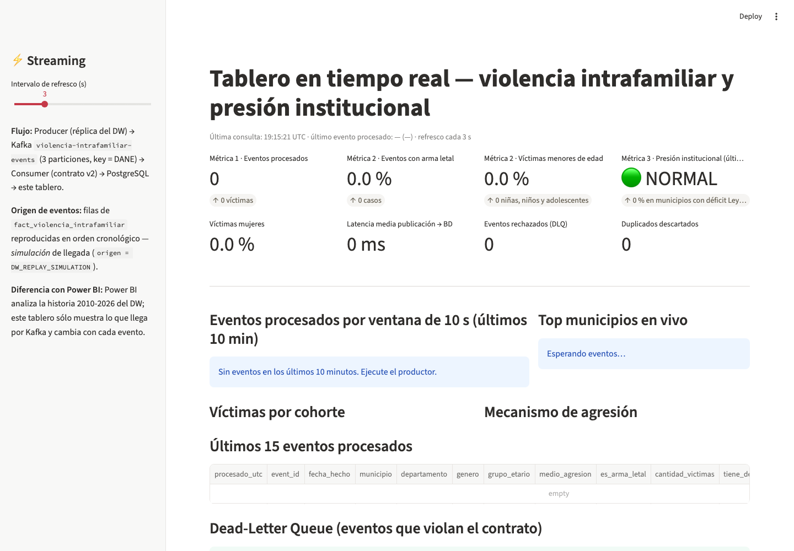 |  |

Full page after the resilience experiments (feed, cohorts, mechanisms and DLQ):
[`docs/img/rt_dashboard_full.png`](docs/img/rt_dashboard_full.png).

**Insights observed in the demo** (60 events of 1 Jan 2026): Bogotá concentrates most victims in the window;
~20 % of the last 50 events fall in municipalities with a comisaría deficit (pressure `NORMAL`); lethal weapons
appear in ~4–5 % of events; the mean publication→database latency is a few milliseconds when the consumer is up.

---

## 10. Execution and reproducibility

### 10.1 Requirements
* Docker Desktop (Compose v2), 8 GB RAM available for Docker.
* For the host-side scripts (producer, experiments, notebook): Python 3.11+ and `pip install -r requirements.txt`.
* Internet access on the first DAG run (datos.gov.co).

### 10.2 Configuration
```bash
cp .env.example .env      # then set DB_PASSWORD (any local value)
```
`.env` is git-ignored. Inside Docker the services use `postgres_dw:5432` and `kafka:29092`; from the host use
`localhost:5432` and `127.0.0.1:9092` (already the defaults in `.env.example`).

### 10.3 Start the stack
```bash
docker compose build
docker compose up -d
docker compose ps        # postgres_dw/kafka healthy, kafka_init exited 0, airflow, stream_consumer, realtime_dashboard up
```
PostgreSQL runs `sql/01_create_dw.sql`, `02_create_streaming_store.sql` and `03_bi_views.sql` on first start.

| Service | URL |
|---|---|
| Airflow UI | http://127.0.0.1:8080 (local demo mode: no login, see §12) |
| Real-time dashboard | http://127.0.0.1:8501 |
| PostgreSQL | `localhost:5432`, database `etl_dw` |

### 10.4 Run and verify the batch pipeline
1. The DAG `etl_violencia_intrafamiliar_final` is unpaused and scheduled `@daily`; it also runs once when the stack
   starts. To run it manually: Airflow UI → *Trigger*, or
   ```bash
   docker exec etl_final_airflow airflow dags trigger etl_violencia_intrafamiliar_final
   ```
2. Controlled quality failure (Test B) and safe rerun (Test C):
   ```bash
   docker exec etl_final_airflow airflow dags trigger etl_violencia_intrafamiliar_final --conf '{"test_mode":"TEST_B_CONTROLLED_FAILURE"}'
   docker exec etl_final_airflow airflow dags trigger etl_violencia_intrafamiliar_final --conf '{"test_mode":"TEST_C_SAFE_RERUN"}'
   ```
3. Verify the DW:
   ```bash
   docker exec etl_final_postgres_dw psql -U postgres -d etl_dw -c "SELECT count(*), sum(cantidad_victimas) FROM fact_violencia_intrafamiliar;"
   ```
   Expected: `701714 | 1501809`. GX results: `docs/evidence/gx_validation_*_latest.json`.
4. Power BI: open the `.pbix`, point the PostgreSQL source to your server if needed and click *Refresh*.

### 10.5 Run and verify streaming
```bash
# the consumer is already running as a service; watch it
docker logs -f etl_final_stream_consumer

# publish 50 new DW facts, one every 0.5 s (from the host)
python streaming/producer.py --count 50 --interval 0.5
#   or fully inside Docker:
docker compose run --rm stream_producer --count 50 --interval 0.5

# include malformed messages (every 10th) to see the DLQ
python streaming/producer.py --count 30 --interval 0.5 --inject-invalid
```
Open http://127.0.0.1:8501 while the producer runs: the metrics, charts and feed change every 3 s.

Resilience experiments (§11.4), with assertions and JSON evidence:
```bash
python streaming/test_resilience.py --events 10
```

### 10.6 EDA notebook
```bash
jupyter notebook notebooks/01_eda_and_profiling.ipynb   # needs the raw files created by the DAG and DB access via .env
```

### 10.7 Reset
```bash
docker compose down        # keep data
docker compose down -v     # also delete the PostgreSQL volume
```

---

## 11. Functional evidence

All evidence below comes from real executions on 2026-11-16 (screenshots of the running system, JSON written by
the code, console logs).

### 11.1 Successful Airflow execution
DAG overview with three runs (scheduled success, Test B failed on purpose, Test C success):
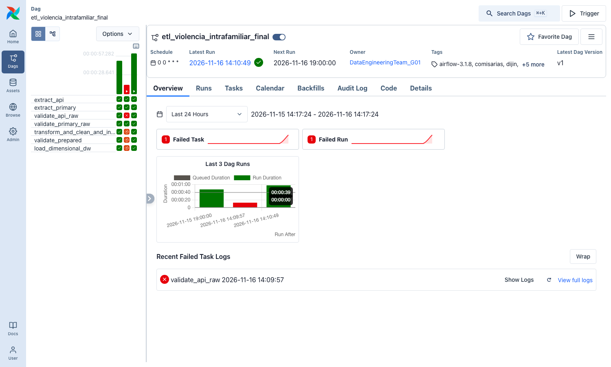

Successful run — all 7 tasks green (≈ 57 s):
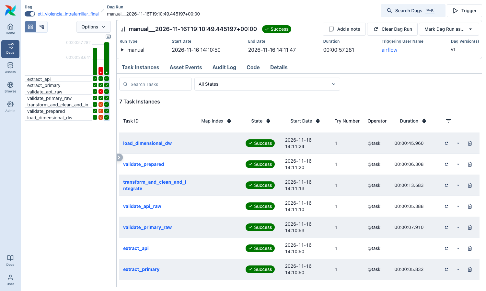

### 11.2 Data quality failure visible in Airflow (Test B)
`validate_api_raw` fails with critical rules DQ-RAW2-01 and DQ-RAW2-04; `transform`, `validate_prepared` and
`load_dimensional_dw` are `upstream_failed`, so the DW is not touched:

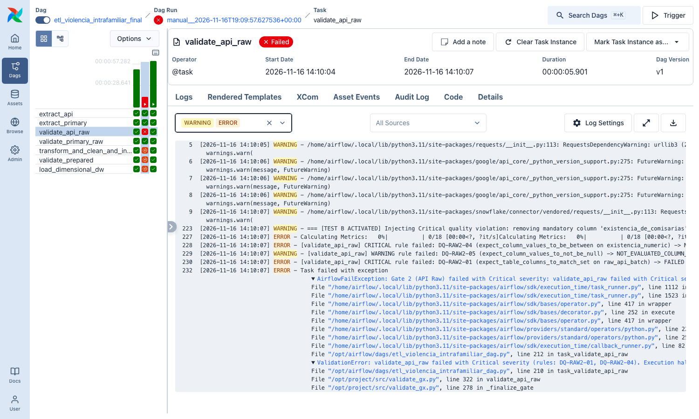

### 11.3 Data Warehouse loading
Reconciliation written by `load_dimensional_dw`: [`docs/evidence/reconciliation_report.json`](docs/evidence/reconciliation_report.json);
table counts and integrity checks: [`docs/evidence/dw_load_check.txt`](docs/evidence/dw_load_check.txt) (§6).
GX results of the same run: [`gx_validation_primary_raw_latest.json`](docs/evidence/gx_validation_primary_raw_latest.json),
[`gx_validation_api_raw_latest.json`](docs/evidence/gx_validation_api_raw_latest.json),
[`gx_validation_prepared_latest.json`](docs/evidence/gx_validation_prepared_latest.json).

### 11.4 Kafka producer / consumer and resilience experiments
Script: [`streaming/test_resilience.py`](streaming/test_resilience.py) · full console log:
[`docs/evidence/streaming_experiments_console.log`](docs/evidence/streaming_experiments_console.log) ·
consumer log excerpt: [`docs/evidence/consumer_log_excerpt.txt`](docs/evidence/consumer_log_excerpt.txt).

**Experiment 1 — invalid events** ([json](docs/evidence/streaming_experiment_1.json)). A contract-violating JSON and a
non-JSON message are published, followed by a valid DW event.
```text
>>> Before: {'eventos': 60, 'victimas': 271, 'invalidos': 0, 'duplicados': 0, 'dlq_rows': 0}
    DLQ #2 p=1 off=16: Event contract validation failed: Expecting value: line 1 column 1 (char 0)
    DLQ #1 p=1 off=15: Event contract validation failed: 17 validation errors for ViolenciaIntrafamiliarEvent
>>> After: {'eventos': 61, 'victimas': 273, 'invalidos': 2, 'duplicados': 0, 'dlq_rows': 2} | consumer alive=True
>>> RESULT: PASS
```
*Observed:* both bad messages are stored in the DLQ with partition/offset and reason, their offsets are committed,
the consumer keeps running and processes the valid event right after them.

**Experiment 2 — consumer interruption** ([json](docs/evidence/streaming_experiment_2.json)). The consumer container
is really stopped (`docker stop`), 10 events are published, then it is restarted.
```text
>>> Step 0 - baseline: {'eventos': 61, ...}, lag=0
    docker stop etl_final_stream_consumer -> running=False
>>> Step 2 - publishing 10 DW events while the consumer is down
>>> Step 3 - while down: metrics={'eventos': 61, ...} | consumer-group lag=10
    docker start etl_final_stream_consumer -> running=True
>>> Step 5 - after restart (3.2s): metrics={'eventos': 71, 'victimas': 321, ...} | lag=0
>>> RESULT: PASS
```
*Observed:* while the consumer is down the metrics freeze and Kafka retains the 10 events (lag = 10). On restart the
group resumes from its last committed offset and processes exactly the 10 events in 3.2 s — no loss, no duplicates.
*Limitations:* the dashboard shows stale values during the outage; the latency metric includes the downtime of
those events (the mean jumps from a few ms to ~1.3 s); events older than the 24 h retention would be lost.

**Experiment 3 — duplicate delivery** ([json](docs/evidence/streaming_experiment_3.json)). An already processed event
is re-published with the same `event_id` → counted as duplicate, metrics unchanged (idempotent sink).

**Streaming metrics updated in the dashboard:** screenshots in §9 (0 → 60 events) and the full page after the
experiments (2 DLQ rows, 1 duplicate):
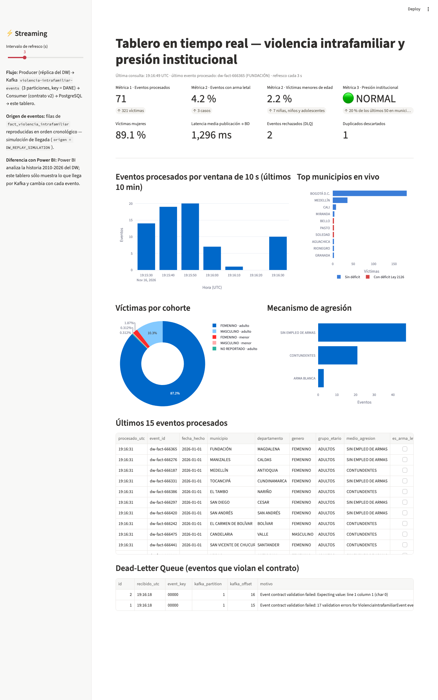

### 11.5 Earlier runner evidence
`src/run_pipeline.py` reproduces tests A/B/C outside Airflow (useful for CI); its outputs are kept in
`docs/evidence/test_a_successful_run.json`, `test_b_controlled_failure.json`, `test_c_safe_rerun.json`.

---

## 12. Engineering decisions and limitations

**Decisions**
1. **Full idempotent reload** of the DW in one transaction: the source is a full snapshot; it guarantees no duplicates
   and an all-or-nothing load (Test C).
2. **Selective retries:** only I/O tasks retry; quality gates and transformations fail fast because they are deterministic.
3. **Exact reconciliation as a critical rule:** the DW must contain exactly the victims and records of the source.
4. **Streaming from the DW, not synthetic data:** events are real fact rows, replayed with a persistent watermark so
   nothing is published twice.
5. **At-least-once + idempotent sink:** manual offset commit after the DB commit and `event_id UNIQUE` give
   effectively-once metrics without Kafka transactions.
6. **DLQ in PostgreSQL** (not a second topic): invalid messages are auditable from the same dashboard.
7. **Kafka key = DANE code:** per-municipality ordering, natural partitioning.
8. **KRaft single broker:** lightweight local deployment.
9. **Polling dashboard (3 s):** simple and compatible with Streamlit; latency bounded by the refresh interval.

**Assumptions:** the API municipal code is the integration key; a municipality's Ley 2126 requirement is the
`comisarias_ley_2126_100_000` field of the API; fact rows of the same day are emitted in a pseudo-random order
because the source has no time of day.

**Known limitations**
* Streaming is a **simulation** (replay of historical facts); there is no live police feed.
* One broker with replication factor 1: no fault tolerance of Kafka itself.
* Streaming metrics are cumulative since the streaming store was created (except M3, which uses a 50-event window);
  re-running `sql/02_create_streaming_store.sql` resets them.
* A full DW reload regenerates `id_hecho`; the producer watermark is date-based, so it keeps working, but the
  `event_id` of an already published day may change after a reload.
* Power BI Desktop runs on Windows only; the `.pbix` uses import mode and must be refreshed after each batch run.

**Reliability and security**
* No credentials in the repository: `.env` is git-ignored and Compose fails fast if `DB_PASSWORD` is missing; no
  default passwords in code.
* All ports are bound to `127.0.0.1`. Airflow uses `SIMPLE_AUTH_MANAGER_ALL_ADMINS=true` **only for local demos**
  (no password stored anywhere); for any shared deployment configure real users and remove that variable.
* Streamlit usage statistics are disabled; Kafka uses PLAINTEXT on the local network (TLS/SASL would be required in
  production).

---

## 13. Objectives achieved

| Objective | Evidence |
|---|---|
| O1 Automated batch ETL | DAG `@daily`, successful runs (§11.1), DW loaded and reconciled (§6, §11.3) |
| O2 Quality gates visible in Airflow | 3 GX suites, 24 rules; Test B blocks the load and shows the failure (§11.2) |
| O3 Historical requirements R1–R7 | Power BI connected to the DW with R1–R7 visuals and insights (§7) |
| O4 Streaming with contract and 3 metrics | Producer from the DW, contract v2, DLQ, idempotent consumer, M1–M3 (§8) |
| O5 Observable real-time dashboard and resilience | Dashboard 0 → 60 events, experiments 1–3 PASS (§9, §11.4) |

---

## 14. Repository structure

```text
.
├── dags/etl_violencia_intrafamiliar_dag.py   # Airflow DAG
├── src/                                      # extract, GX validation, transform, star schema, load, runner
├── gx/                                       # GX suites, checkpoints, validation definitions
├── sql/                                      # 01 DW DDL · 02 streaming store · 03 BI views
├── streaming/                                # contract, producer, consumer, db helper, resilience experiments
├── dashboard/
│   ├── app_realtime.py                       # Streamlit real-time dashboard
│   └── batch/                                # Power BI .pbix + R1–R7 captures
├── notebooks/01_eda_and_profiling.ipynb      # EDA (executed)
├── imagenes/                                 # system architecture and star-schema diagrams
├── docs/
│   ├── architecture/                         # architecture diagram (.mmd + .png)
│   ├── img/                                  # EDA figures and execution screenshots
│   └── evidence/                             # GX results, reconciliation, experiments, logs
├── data/raw/*_manifest.json                  # source manifests (data files are git-ignored)
├── docker-compose.yaml · Dockerfile · requirements.txt · .env.example · .gitignore
```
