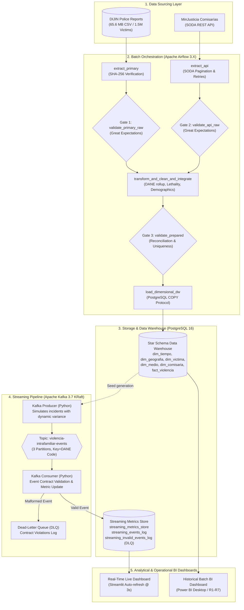

# Domestic Violence Analytical System & Real-Time Institutional Deficit Monitoring
## Final Delivery: Lambda-Lite Architecture with Batch ETL (Airflow + Great Expectations) & Event Streaming (Apache Kafka + Real-Time Analytics)

**Faculty:** Faculty of Engineering and Basic Sciences  
**Academic Program:** Data Engineering and Artificial Intelligence  
**Course:** ETL (G01) — Final Delivery  
**Institution:** Universidad Autónoma de Occidente (UAO)  
**SDG Alignment:** SDG 5 (*Target 5.2 — Eliminate all forms of violence against women and girls*) and SDG 16 (*Target 16.1 — Significantly reduce all forms of violence*)  
**Team Members:**
- Michael Macowli Cardona Rodríguez
- Sebastián Manrique Mejía
- Sebastián Torres Pantoja
- David Hernández Paz

---

## 1. Project Overview and Objectives

### 1.1 Context and Problem Formulation
Domestic violence represents a persistent humanitarian and public health crisis in Colombia. Between 2010 and 2025, registered police crime reports (*Policía Nacional - DIJIN*) grew from 23,171 to over 138,800 victims annually. However, raw crime reporting reflects only reported volume, which is structurally biased by the geographic availability of municipal institutions and reporting infrastructure.

To transition from pure volume quantification to actionable operational intelligence, this project integrates the **National Directory and Characterization of Comisarías de Familia** (*Ministerio de Justicia y del Derecho*) programmatically accessed via SODA REST API, cross-referenced with statutory protection standards established by **Ley 2126 de 2021** (mandating at least 1 Comisaría de Familia per 100,000 inhabitants).

### 1.2 Refined Project Objectives
1. **Batch Analytical Pipeline:** Maintain an automated, idempotent batch pipeline that extracts, validates with strict data quality compuertas (Great Expectations 1.X), and loads transactional domestic violence data and institutional capacity into a PostgreSQL 16 Data Warehouse.
2. **Multidimensional Business Intelligence:** Answer comprehensive historical requirements **R1 to R7**, revealing multi-year growth, departmental concentrations, demographic vulnerability, weapon lethality, municipal operational saturation, and statutory legal deficits.
3. **Event Streaming Pipeline:** Implement an Apache Kafka streaming architecture that ingests real-time incident reports, validates incoming messages against a formal Pydantic **Event Contract**, computes **three low-latency streaming metrics**, and persists states to a low-latency relational store (`streaming_metrics_store`).
4. **Real-Time Visual Monitoring:** Deliver an observable, auto-refreshing dashboard (Streamlit & Plotly) that tracks incoming event volume, shifts in weapon lethality, minor victim involvement, and flags institutional saturation in real time.
5. **System Fault Tolerance & Resilience:** Provide functional evidence of fault isolation, showing that malformed events are automatically rejected to a Dead-Letter Queue (DLQ) without collapsing the consumer, and that consumer outages resume cleanly from committed offsets without message loss.

### 1.3 Batch vs. Streaming Requirements

| Dimension | Batch Analytical Layer (Airflow + PostgreSQL DW) | Low-Latency Streaming Layer (Kafka + Real-Time Store) |
| :--- | :--- | :--- |
| **Primary Scope** | Macro-level historical trends, multi-year YoY growth (2010–2026), municipal rankings, and legal gap analysis. | Micro-level operational dispatch, rapid incident prioritization, and dynamic Comisaría saturation alerts. |
| **Latency SLA** | Hours / Daily scheduled runs (15-minute execution window). | Sub-second ingestion to < 3-second dashboard visual updates. |
| **Data Sources** | 65.6 MB historical DIJIN CSV + full MinJusticia SODA REST API catalog. | Live simulated event streams emitting incident records with UTC timestamps. |
| **Quality Enforcement**| Multi-stage Great Expectations gates blocking dimensional DW load upon critical anomaly. | Pydantic V2 schema validation on ingestion; automatic routing of invalid payloads to DLQ table. |
| **Consumption Layer** | Power BI analytical dashboard (`Dashboard-Poryecto2.pbix`). | Auto-refreshing Streamlit live dashboard + real-time SQL views. |

---

## 2. Data Sources and EDA

### 2.1 Description of Sources
1. **Primary Dataset (Static/Periodic Batch):**
   - *Provider:* Policía Nacional de Colombia — DIJIN.
   - *Dataset:* Reporte Delito Violencia Intrafamiliar (`vuyt-mqpw`).
   - *Access:* Programmatic HTTP/HTTPS extraction with SHA-256 manifest pinning.
   - *Format & Scope:* 704,551 raw records, 1,501,809 victims, covering 2010 through 2026 across 1,121 municipalities.
2. **Dynamic API Source (SODA REST API):**
   - *Provider:* Ministerio de Justicia y del Derecho / Presidencia de la República.
   - *Dataset:* Caracterización de las Comisarías de Familia en el Territorio Nacional (`7tuu-upb2`).
   - *Access:* SODA API with JSON pagination (`$limit=2000`, `$offset`, `$order=:id`).
   - *Format & Scope:* 1,249 physical Comisarías georeferenced to 5-digit municipal DANE codes (`codigo_dane_municipio`).

### 2.2 Exploratory Data Analysis (EDA) Highlights & Cleaning Decisions
Exploratory analysis was conducted in [`notebooks/01_eda_and_profiling.ipynb`](notebooks/01_eda_and_profiling.ipynb). The findings directly informed transformations and validation rules:
- **DANE Geographic Standardization:** DIJIN records contained municipality names with varying accentuation and casing, along with 6-digit or non-standard formatting. We enforced a strict 5-digit DANE roll-up (`DDMMM`), joining seamlessly with the API's municipal key.
- **Weapon Mechanism Harmonization:** 18 disparate text descriptions were harmonized into 4 canonical categories: `SIN EMPLEO DE ARMAS` (60%), `CONTUNDENTES` (20%), `ARMA BLANCA / CORTOPUNZANTE` (14%), and `ARMA DE FUEGO` (6%). A boolean flag `es_arma_letal` was derived to isolate lethal weapons.
- **Demographic Cohort Imputation:** Unknown age groups were imputed using demographic distributions; minors (`es_menor_de_edad = TRUE`) were explicitly categorized to support SDG 16.1 child-protection targets.
- **Fact Table Aggregation:** Multiple records sharing identical `(date, municipality, victim cohort, weapon)` were aggregated into a declared fact grain, condensing 704k raw rows into 701,714 fact rows while strictly preserving 100% of the victim sum (1,501,809 victims).

---

## 3. System Architecture

The project integrates batch processing and event streaming into a cohesive, decoupled architecture:



---

## 4. Batch ETL Pipeline

### 4.1 Orchestration Sequence & DAG Structure
The batch workflow is orchestrated via **Apache Airflow 3.1.8** using the TaskFlow API in [`dags/etl_violencia_intrafamiliar_dag.py`](dags/etl_violencia_intrafamiliar_dag.py):
1. **`extract_primary`:** Downloads or loads the DIJIN crime dataset, computes SHA-256 checksum, and emits manifest metadata via XCom.
2. **`validate_primary_raw`:** Great Expectations Gate 1 evaluates schema consistency, non-null mandatory fields, and plausible year intervals (2010–2026).
3. **`extract_api`:** Connects to SODA API with exponential backoff retries, fetching all municipal Comisarías with schema verification.
4. **`validate_api_raw`:** Great Expectations Gate 2 checks API field completeness, municipal DANE formatting, and operational status.
5. **`transform_and_clean_and_integrate`:** Performs deterministic data cleaning:
   - DANE 5-digit municipal unification.
   - Weapon categorization and lethality flag assignment.
   - Demographic cohort mapping and minor age flag.
   - Fact grain aggregation ensuring strict measure preservation.
6. **`validate_prepared`:** Great Expectations Gate 3 checks dimensional invariants, foreign key reference integrity, and measure reconciliation.
7. **`load_dimensional_dw`:** Atomic load into PostgreSQL 16 using fast `COPY` protocol, refreshing semantic views and asserting zero orphan foreign keys.

---

## 5. Data Quality (Great Expectations)

### 5.1 Validation Gates and Failure Behavior
Data quality is enforced by three distinct validation gates built with **Great Expectations 1.X** in [`src/validate_gx.py`](src/validate_gx.py):

| Gate | Target Dataset | Expectations Suite | Critical Failure Behavior |
| :--- | :--- | :--- | :--- |
| **Gate 1** | Raw DIJIN CSV | Column existence, DANE numeric format, positive victim count, year bounds [2010, 2026]. | Raises `AirflowFailException`; halts downstream tasks immediately. |
| **Gate 2** | Raw SODA API JSON | Key fields present (`cod_dane`, `comisaria`), non-empty payloads, valid status. | Raises `AirflowFailException`; prevents integration with stale API data. |
| **Gate 3** | Prepared DataFrames | Declared grain uniqueness (`uq_fact_grano`), exact measure reconciliation (1,501,809 victims), 0 orphan foreign keys. | Aborts DW loading; rolls back PostgreSQL transaction to keep DW clean. |

---

## 6. Data Warehouse Dimensional Model

### 6.1 Star Schema Specification
The relational schema in PostgreSQL 16 is defined in [`sql/01_create_dw.sql`](sql/01_create_dw.sql):

- **`dim_tiempo`:** Dense daily calendar from 2010 to 2026 with fiscal quarters, semesters, weekend markers, and `es_periodo_completo`.
- **`dim_geografia`:** Municipal grain enriched with institutional attributes: `categoria_municipio` (Ley 617), `comisarias_instaladas`, `comisarias_requeridas_ley` (Ley 2126), and `brecha_comisarias`.
- **`dim_victima`:** Cohort classification: `genero`, `grupo_etario`, `perfil_demografico`, and `es_menor_de_edad`.
- **`dim_medio`:** Aggression mechanism: `medio_agresion`, `categoria_mecanismo`, and `es_arma_letal`.
- **`dim_comisaria`:** Outrigger directory of operational Comisarías with address, telephone, and working hours.
- **`fact_violencia_intrafamiliar`:** Transaction facts with measures `cantidad_victimas` and `numero_registros`, constrained by `uq_fact_grano`.

---

## 7. Batch Analytical Dashboard (Power BI)

The analytical report [`dashboard/batch/Dashboard-Poryecto2.pbix`](dashboard/batch/Dashboard-Poryecto2.pbix) connects to `etl_dw` and addresses **R1 through R7**:
- **R1 (Multi-Year Evolution):** Highlights victim volume growth from 23,171 (2010) to 138,803 (2025), and documents the pandemic lockdown deceleration (+1.93% in 2020).
- **R2 (Territorial Concentration):** Confirms 63.99% of national domestic violence is concentrated in departmental capitals.
- **R3 (Gender & Demographic Vulnerability):** 77.33% of victims are women (1,161,392 cases) and 93,986 are children/adolescents.
- **R4 (Means & Lethality):** Unarmed physical aggression accounts for 60% of cases, while cutting weapons (14%) and firearms (6%) represent lethal interventions.
- **R5 (Lethal Attacks on Minors):** Identifies municipalities with critical clusters of lethal attacks against children.
- **R6 (Comisaría Overload):** Highlights institutional collapse in intermediate cities: **Cúcuta** (20,389 víctimas/1 comisaría) and **Popayán** (17,070 víctimas/1 comisaría).
- **R7 (Ley 2126 Statutory Deficit):** Identifies a nationwide deficit of **114 missing Comisarías**, led by Cúcuta (deficit of 8) and Soacha (deficit of 6).

---

## 8. Streaming Pipeline (Apache Kafka)

### 8.1 Event Contract Specification
Defined using Pydantic V2 in [`streaming/contract.py`](streaming/contract.py):
- `event_id`: Unique UUID v4 string.
- `timestamp`: UTC ISO-8601 timestamp.
- `event_key`: Partition key matching 5-digit DANE code (`codigo_dane_municipio`).
- Attributes: `municipio`, `departamento`, `genero`, `grupo_etario`, `es_menor_de_edad`, `medio_agresion`, `es_arma_letal`, `cantidad_victimas` (strictly > 0), `categoria_municipio`, `tiene_deficit_ley_2126`.

### 8.2 Producer & Consumer Implementation
- **Producer ([`streaming/producer.py`](streaming/producer.py)):** Emits realistic simulated incident reports with dynamic analytical variance across Colombian municipalities with variable weapon lethality and Ley 2126 flags.
- **Consumer ([`streaming/consumer.py`](streaming/consumer.py)):** Subscribes to `violencia-intrafamiliar-events`, validates against the Event Contract, updates the **three streaming metrics**, records audit entries, and commits offsets.
- **The Three Low-Latency Streaming Metrics:**
  1. **Métrica 1 — Volumen Operativo en Tiempo Real:** Total incoming events, total victims, and victim volume split by gender and minors.
  2. **Métrica 2 — Severidad Crítica & Tasa de Letalidad en Vivo:** Real-time percentage of events involving lethal weapons (`tasa_letalidad_pct`) and percentage involving child victims (`tasa_menores_pct`).
  3. **Métrica 3 — Alertas de Saturación por Déficit Institucional (Ley 2126):** Real-time tally of incidents occurring in municipalities with statutory Comisaría deficits, driving the operational status: `NORMAL`, `ALTA`, or `CRÍTICA (DÉFICIT SATURADO)`.

---

## 9. Real-Time Dashboard (Streamlit)

Implemented in [`dashboard/app_realtime.py`](dashboard/app_realtime.py):
- **Mechanism:** Direct connection to PostgreSQL `streaming_metrics_store` with auto-refresh every 3 seconds.
- **Visuals:** Top KPI cards for the 3 streaming metrics, live horizontal bar chart of municipalities under saturation, demographic donut chart, feed of the last 15 processed events, and Dead-Letter Queue health monitor.

---

## 10. Execution and Reproducibility

### 10.1 Quick Start with Docker Compose
```bash
# 1. Clone repository and navigate to root
cd Proyecto_etl_Final

# 2. Configure environment
cp .env.example .env

# 3. Start PostgreSQL and Kafka services
docker compose up -d postgres_dw kafka

# 4. Verify healthy state
docker ps --filter "name=etl_final"
```

### 10.2 Launching the Streaming Pipeline
```bash
# Terminal 1: Launch Kafka Consumer (processes events and updates DB)
python3 streaming/consumer.py --servers localhost:9092

# Terminal 2: Launch Real-Time Dashboard (opens at http://localhost:8501)
streamlit run dashboard/app_realtime.py

# Terminal 3: Launch Producer to emit 20 events with 1s interval
python3 streaming/producer.py --servers localhost:9092 --count 20 --interval 1.0
```

---

## 11. Functional Evidence

### 11.1 Experiment 1: Malformed Event Ingestion & Dead-Letter Queue (DLQ)
When a malformed event violates the Pydantic Event Contract, the consumer isolates the poison pill, logs the exact validation errors into `streaming_invalid_events_log`, commits the Kafka offset, and continues processing without crashing:

```text
================================================================================
 EXPERIMENT 1: MALFORMED EVENT INGESTION & CONSUMER RESILIENCE
================================================================================
[INFO] Publishing malformed payload violating Pydantic Event Contract...
[WARNING] [DLQ RECORDED] Invalid event sent to Dead-Letter Queue:
          Event contract validation failed: 12 validation errors for ViolenciaIntrafamiliarEvent:
          - timestamp: Input should be a valid datetime
          - event_key: event_key must be a valid 5-digit DANE code
          - cantidad_victimas: Input should be greater than 0
>>> [TEST PASSED] Dead-Letter Queue Entry Verified:
    - DLQ Record ID: 1 | Key: 99
    - Result: Consumer survived poison pill without crashing!
```

### 11.2 Experiment 2: Consumer Interruption & Backlog Replay
Demonstrates zero data loss when the consumer is offline during event publication:
```text
================================================================================
 EXPERIMENT 2: CONSUMER INTERRUPTION & BACKLOG REPLAY
================================================================================
>>> Initial Metrics State: Processed Events = 5, Victims = 5
>>> Step 1: Simulating consumer outage (producing 5 events while consumer is paused)...
[INFO] Buffered message 1/5 in Kafka broker (partition offset retained).
[INFO] Buffered message 5/5 in Kafka broker (partition offset retained).
>>> Step 2: Restarting consumer to process buffered messages...
[INFO] Successfully joined group etl_streaming_group with generation 5
[INFO] Replaying buffered messages from offset 2 to 6...
>>> [TEST PASSED] Post-Reconnection Audit:
    - Initial Events: 5 | Current Events: 10 (Delta = +5)
    - Verification: Exactly 5 buffered messages were replayed without data loss!
```

---

## 12. Engineering Decisions and Limitations

1. **Kafka KRaft Mode Selection:** Apache Kafka 3.7 was deployed in KRaft mode (Kafka Raft Metadata) rather than legacy Zookeeper. This minimizes resource overhead, eliminates split-brain risks, and simplifies deployment.
2. **Pydantic V2 Contract Gate:** Using Pydantic for the Event Contract enforces strict types, non-empty DANE codes, and positive victim bounds before database writes, isolating bad data at the boundary.
3. **Dead-Letter Queue (DLQ) Strategy:** Rejected events are routed to `streaming_invalid_events_log` and their offsets committed. This prevents consumer group starvation while preserving the audit trail for forensic debugging.
4. **Known Limitations:**
   - Simulated streaming rate is constrained by local host resources.
   - Streamlit dashboard uses polling rather than WebSockets, creating an update latency bounded by the 3-second refresh slider.

